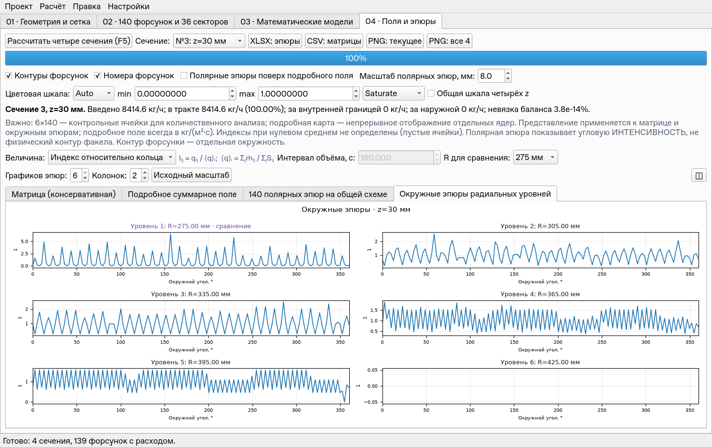
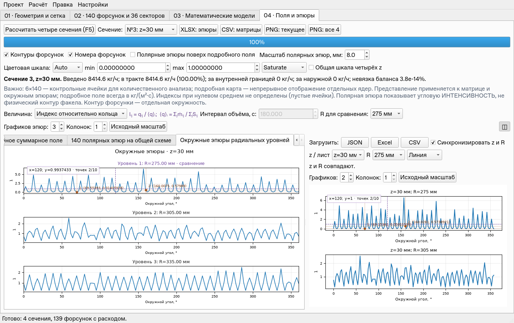
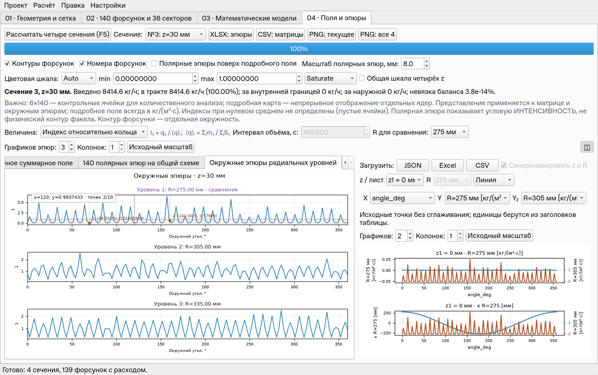

# Validation v0.3.1 — интерфейс, взаимодействия и отклик

Основа: рабочая v0.3.0, исходные 123 теста; ветка создана от `76485c1`
(дерево исходников совпадает с выпуском `94cd95c`). Отработка на
`examples/demo_project_user_field.json`, его содержимое сохранено.
Физическая модель, измерения, методика Дитякина и формат проектов не менялись.

## Замечания 1–7

1. Вкладка 04 показывает уравнение рядом с выбранной величиной. Переключение
   величины немедленно обновляет формулу; подсказка объясняет ṁ [кг/с],
   S [м²], ρ [кг/м³] и t [с]. Средние индексов взвешены по площади.
2. По умолчанию одна область. Кнопка split ◫ над графиками справа открывает
   вторую область. JSON/Excel/CSV находятся только в ней. Повторное нажатие
   скрывает её с сохранением загруженных данных. Граница перетаскивается,
   случайное полное схлопывание видимой панели запрещено.
3. В обеих областях регулируются число эпюр и число колонок. В основной
   области последовательные радиальные уровни начинаются с выбранного R;
   при выборе всего набора — с первого уровня. В split-проекте — с его R.
   Для таблиц начальный Y и следующие числовые столбцы образуют набор,
   исключая X и дополнительную Y₂. Подписи показывают каждый выбранный столбец.
   Количественная матрица и подробные карты остаются самостоятельными полями.
4. Общий контроллер взаимодействий на основных окружных эпюрах и всех
   графиках сравнения: автоматический прицел x/y, фиксация до 10 точек двойным
   ЛКМ, удаление точек сочетанием ЛКМ+ПКМ, zoom прямоугольником средней кнопкой.
   Есть кнопка исходного масштаба, клавиша R и отмена выделения Esc.
   Для линии точка проецируется на ближайший сегмент в экранных координатах;
   разрывы NaN не соединяются. Для scatter выбирается исходная точка,
   для столбцов — центр вершины. При двух Y сохраняются собственные единицы
   каждой оси, прицел показывает обе координаты Y. Выделение масштабирует
   обе Y без повторного преобразования уже изменённой общей X.
5. Настройки импортированной таблицы расположены над её canvas, с выбором
   X/Y/Y₂, типа диаграммы, числа графиков/колонок и сбросом масштаба рядом.
   Длинные подписи осей переносятся; они проверены при нескольких графиках.
6. Списки расположены непосредственно после подписей, свободное место
   остаётся справа. UI/UX-тесты проверяют зазор менее 20 пикселей,
   положение split-кнопки, отсутствие выхода полей за границу и фактическую
   ширину окна при 1280, 1480 и 1920 пикселях. Для таблиц расстояние от её
   настроек до canvas проверяется меньше 150 пикселей. Дополнительно
   просмотрены снимки одной области, split с точками и импортированного XLSX.
7. Прицел, добавление и удаление точек используют готовый фон и blitting:
   полное построение графиков и физический расчёт не запускаются. Zoom
   перестраивает подписи/оси один раз после отпускания средней кнопки.
   Скорость измерена для основной области, второго проекта и таблицы с двумя Y.

Пометки принадлежат данным/представлению текущего набора. Изменение данных,
единиц или его раскладки сбрасывает соответствующие пометки. Кэш основных
эпюр сохраняет их при возвращении к неизменённому виду. Изменение раскладки
слева не перестраивает неизменённый график справа и не стирает его пометки.
Переключение split сохраняет загруженные данные. Все операции отображения
сохраняют исходные числовые массивы, расходы и номер ревизии модели.

## Проверки

**142 теста прошли, 0 пропусков**, 32.738 с. Исходные 123 теста прошли до
изменений; добавлены 19 сценариев жестов и UI/UX. Предыдущая проверка количества
линий уточнена: вспомогательные анимированные оси не считаются исходной эпюрой.
Проверены реальные кнопки JSON/Excel/CSV и их фильтры, Qt mouse move/double
click/chord/middle drag и R, 10-точечный предел,
попадание на линию, scatter и столбцы, разрывы NaN, выход мыши из графика,
zoom и восстановление двух Y, resize/PNG, отсутствие полного redraw при
прицеле/фиксации/очистке, оба окна, cache, подписи и размеры элементов.

```bash
QT_QPA_PLATFORM=offscreen MPLCONFIGDIR=/tmp/injector-mpl \
 /workspace/.venvs/injector-analytics/bin/python -B -m unittest discover -s tests

QT_QPA_PLATFORM=offscreen MPLCONFIGDIR=/tmp/injector-mpl \
 /workspace/.venvs/injector-analytics/bin/python -B tools/benchmark_plot_interaction.py \
 --out /tmp/plot_latency.json
```

## Замеры отклика

Linux, Python 3.12, Qt offscreen, окно 1480×930. Замер включает обработку
Matplotlib-события и Qt `processEvents()`/painting; прогрев исключён.
Для прицела по 150 событий на сценарий, для добавления 10 точек, zoom 10
выделений. Интерпретировать как измерение облачной среды, не гарантию для
любого компьютера. Windows/Spyder по указанию пользователя не проверялись.

Все времена в миллисекундах; прицел — медиана / 95-й процентиль.

| Область | Прицел, 0 точек | Прицел, 10 точек | Добавление: p95 | Zoom: p95 | Удалить 10 |
| --- | ---: | ---: | ---: | ---: | ---: |
| Основная: 6 эпюр | 2.12 / 2.23 | 2.86 / 5.06 | 15.88 | 132.04 | 1.05 |
| Split: 6 эпюр | 2.12 / 2.24 | 2.88 / 2.95 | 15.55 | 112.00 | 1.12 |
| Таблица: две Y | 2.59 / 3.41 | 3.34 / 3.44 | 15.05 | 60.46 | 0.91 |

Полный redraw измерен отдельно как альтернативный путь отображения,
а не как поведение предыдущей версии. Исходные значения, число ревизии,
объект результатов и все четыре массива сохранены после замеров;
максимальная относительная невязка баланса 9.31·10⁻¹⁵.
Сырые замеры и reference redraw: [V0.3.1_LATENCY.json](V0.3.1_LATENCY.json).
Подсветка прямоугольника занимает менее миллисекунды в последнем замере;
сам zoom существенно дороже прицела из-за обновления шкал и подписей.

## Визуальная проверка

Одна область по умолчанию:



Split, разное число эпюр, закреплённые точки и прицел в обеих областях:



Настройки импортированного XLSX рядом с графиками и две оси Y:



## Предложения для следующих версий

- Связанные прицел и zoom двух областей по физическому углу, чтобы сравнивать
  одинаковый участок эпюры; для несовместимых осей — независимый режим.
- Выбор, перетаскивание и удаление отдельной вспомогательной точки,
  Undo/Redo пометок отдельными действиями.
- Измерение Δx/Δy между двумя точками и статистика выбранного диапазона:
  минимум, максимум, среднее и интегральный расход контрольных ячеек.
- Экспорт пометок и выбранных диапазонов в CSV/Excel вместе с единицами;
  сохранение пометок сеанса отдельно от физических исходных данных.
- Pan перетаскиванием и zoom вращением колёсика относительно курсора,
  клавиатурный переход между экспериментальными точками.
- Произвольный выбор нескольких Y-серий вместо последовательных столбцов,
  их наложение с легендой и переключаемой видимостью.
