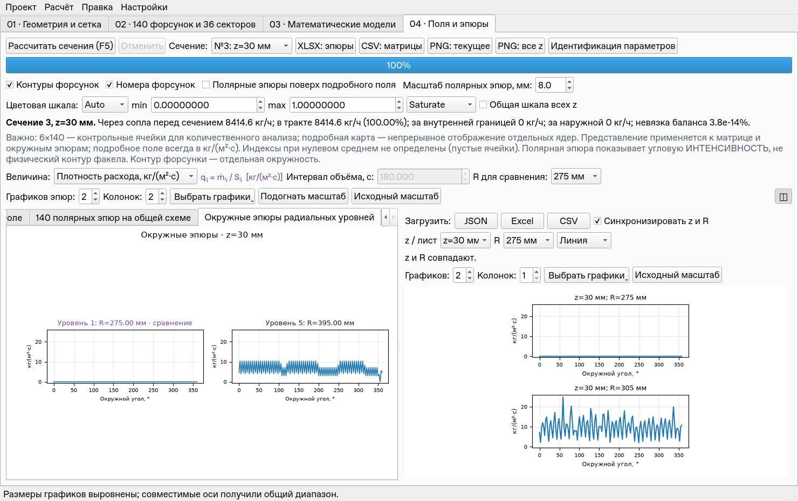
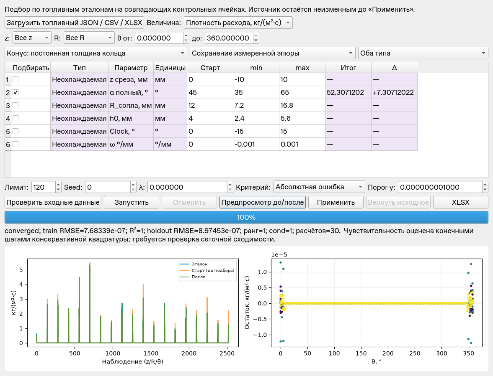
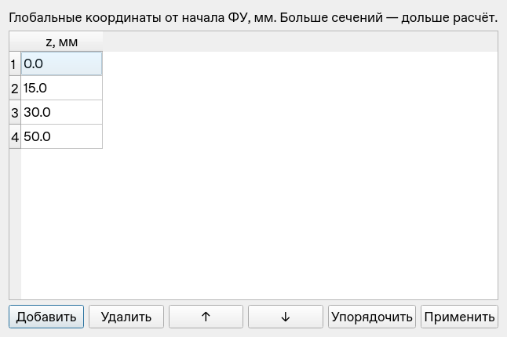

# Validation v0.4.0

База: `main` SHA **1752485**, v0.3.1 и согласованные документы v0.4/v0.5.
Исходные **142 теста прошли** до правок. Этапы сохранены отдельными коммитами:
A `8bb4cae` — срезы сопел; B `497f1ac` — N сечений и графики; C — регрессия.
Работа выполнена только в объёме v0.4. Исходный
`examples/demo_project_user_field.json` не изменён.

## Замечания к v0.3.1

1. Ctrl + нажатие колёсика возвращает исходные диапазоны всех эпюр данного
   canvas. Сброс R/кнопкой также сохранён. Средняя кнопка без Ctrl оставляет
   прежнее выделение прямоугольника. Проверено настоящим QTest mouseClick
   с ControlModifier, не только непосредственным вызовом обработчика.
2. «Выбрать графики» в обеих областях позволяет отметить произвольные
   радиальные уровни/числовые Y-серии. Количество обновляется автоматически,
   последнее поле нельзя случайно убрать. При смене сетки выбор проверяется
   по физическим радиусам, а не прежним индексам.
3. «Подогнать масштаб» выравнивает split-области и размеры plot-area в пикселях;
   совместимые пары X/Y получают общий диапазон. Это изменение представления,
   не чисел. Температура сохраняет свою ось, разные единицы не объединяются.
   В тесте разные выбранные уровни имеют одинаковые диапазоны и размеры осей
   с точностью до 1 пикселя. Изменение не запускает физический пересчёт.

## A. z_tip и локальное z

`Nozzle.z_tip_mm` наследуется от cooled/uncooled и допускает индивидуальный
geometry_override. Старые шаблоны/форсунки получают 0. Во всех консервативных
и гладких путях используется z_local=z_plane−z_tip ровно один раз; Clock и
ω, угловое затухание и диффузия используют ту же локальную координату.
До среза нет вклада, на срезе начальный профиль. На схемах ненулевой z среза
подписан рядом с ID; одиночное превью строится на срезе.

Баланс сечения относится к расходам форсунок, уже пересекающих эту плоскость.
Форсунки дальше по потоку сохраняются в геометрии и измерениях, но не
прибавляются к injected этого сечения. При tip=0 исторические поля совпадают
с прежними независимыми fixtures. Проверены наследование, override, смешанные
срезы, отсутствие поля до среза, равенство поля после переноса начала z,
оба вида полей, угловые профили и индивидуальные эпюры.

## B. 1–50 сечений

Проверяются конечные неотрицательные координаты и уникальность с допуском
10⁻⁷ мм. Порядок сохраняется; редактор позволяет добавить/удалить,
переместить и упорядочить строки. Начальный набор остаётся четырьмя.
Worker рассчитывает N, прогресс учитывает N, отмена не применяет частичный
набор и сохраняет ранее рассчитанные поля при повторном запуске.
Сохранение, сравнение по физическому z/R, CSV, PNG и XLSX работают с N;
имена N листов уникальны и не длиннее 31 символа.
Проверены N=1,4,7, ошибки координат, реальный worker и отмена, повторный
расчёт и пакетный пример с семью сечениями.

## C. Топливная регрессия

Чистый модуль `regression.py` не импортирует Qt. Интерфейсы:
RegressionTarget, ParameterSpec, FitResult, RegressionSnapshot.
Прямой оператор — существующее calculate_plane с точным контролем баланса.
Поиск: SciPy **1.16.3** least_squares, box constraints, конечные шаги в
нормированных диапазонах и воспроизводимое начальное исследование.

Подбираются наследуемые параметры типов, с явными start/min/max, budget,
seed, λ, absolute/relative критерием и порогом малых y. Действующие
индивидуальные overrides остаются. Неприменимые коэффициенты исключены
по выбранным моделям и используемым z/маскам. Геометрия кандидатов проверяется
на всех используемых сечениях. Бюджет учитывает поиск и диагностику.
Температурные и нормированные температурные эталоны отклоняются.

Физические R/θ сопоставляются с центрами ячеек; периодический угол учитывается,
но скрытая интерполяция/переименование величин отсутствует. Проверяются
единицы, источник, маски, веса, дубликаты, контрольные области и площади.
RMSE/MAE/R² показаны отдельно для train и holdout/test. При постоянном y R²
не определён. Ранг, условность Jacobian, active bounds и условная standard_error
сохраняются в отчёте; они не подтверждают единственность. Дискретная модель
требует отдельной проверки сеточной сходимости.

Предпросмотр и остатки доступны до применения. Снимок — неизменяемая
каноническая JSON-строка с SHA256. Применение — одна операция Undo/Redo;
полный rollback восстанавливает снимок точно. Дополнительные пользовательские
поля верхнего уровня, settings и nozzle сохраняются. Применение устаревшего
результата блокируется. Worker и загрузка эталона не блокируют Qt, отмена
проверяется между прямыми расчётами. Исходные sector_ml, Gт и характеристики
не меняются ни поиском, ни применением геометрических коэффициентов.

XLSX содержит Parameters, Metrics, Residuals, Metadata, Validation.
N/A явный; snapshots разбиты на части по 16000 символов. Экспорт дополнительно
открыт openpyxl. Контракт ввода: [V0.4_REGRESSION_FORMAT.md](V0.4_REGRESSION_FORMAT.md).

## Синтетические восстановления

Данные получены численной моделью с известным параметром, не являются
экспериментом. 24 радиальные × 360 окружных интеграционных проб источника,
3 активные форсунки из сохранённых 140 позиций, 3 сечения 10/25/45 мм,
остальные источники выключены; 20% углов оставлены для holdout.
Параметры восстанавливаются отдельно, не как коррелирующий многопараметрический fit.

| Параметр | Эталон | Оценка | Независимая проверка |
| --- | ---: | ---: | --- |
| α, град | 52.3 | 52.3071202 | holdout RMSE 8.97·10⁻⁷, R² 0.999999999989 |
| k_linear | 0.14 | 0.140290312 | holdout RMSE 1.29·10⁻⁴, R² 0.999999776 |
| Clock | 12° | в пределах 0.7° | holdout R² >0.999 |

Допуски относятся к данной дискретной сетке. Повторный seed/ввод воспроизводит
результат. Проверены нормированный топливный эталон, относительный критерий,
budget/cancel, постоянная цель, неверные координаты/единицы, неактивный
коэффициент, полнота rollback и сохранение измерений/массового баланса.
В examples есть отдельные явно синтетические проект/эталон на геометрии
пользовательского проекта: семь сечений и known cooled/alpha_deg=66°.

## Проверки и воспроизведение

**168 тестов прошли**, 0 пропусков, 98.389 с; включая 26 новых проверок v0.4, baseline 142.
Linux, Python 3.12.14, PyQt5 5.15.11, SciPy 1.16.3, NumPy 2.5.4.
Windows/Spyder по прежнему указанию пользователя не проверялись.

```bash
QT_QPA_PLATFORM=offscreen MPLCONFIGDIR=/tmp/injector-mpl \
 /workspace/.venvs/injector-analytics/bin/python -B -m unittest discover -s tests

MPLCONFIGDIR=/tmp/injector-mpl \
 /workspace/.venvs/injector-analytics/bin/python -B batch_run.py \
 examples/demo_project_v04_synthetic.json --out /tmp/v04-seven
```

GUI smoke: исходный пользовательский проект, F5, выбор отдельных эпюр,
независимый JSON справа, подгонка масштабов; реальный подбор α в worker,
предпросмотр, применение и восстановление SHA256. Максимальная относительная
невязка пользовательского проекта — 9.31·10⁻¹⁵.

## Отклик

Замер включает Matplotlib-событие и Qt painting/processEvents; по 150 событий
прицела с десятью пометками, 10 добавлений и 10 выделений. Времена —
медиана / p95 в миллисекундах, окно 1480×930, Qt offscreen.

| Область | Прицел, 10 точек | Добавить точку | Zoom после отпускания |
| --- | ---: | ---: | ---: |
| Основная: 6 эпюр | 7.22 / 10.30 | 27.97 / 40.46 | 345.31 / 546.45 |
| Split: 6 эпюр | 7.92 / 20.38 | 31.70 / 50.66 | 274.25 / 295.80 |
| Таблица: две Y | 8.45 / 11.06 | 26.85 / 40.10 | 124.70 / 132.24 |

Сырые замеры и full-redraw reference: [V0.4_LATENCY.json](V0.4_LATENCY.json).
Нагрузка/быстродействие этой облачной среды отличаются от предыдущего выпуска;
прямое сравнение чисел разных запусков не является изолированным benchmark.
Прицел и пометки не вызывают полного redraw/пересчёта; zoom перерисовывает
шкалы/подписи и остаётся существенно дороже. Все исходные массивы, результаты
и номер физической ревизии сохранены после замеров.

## Интерфейс







## Ограничения

Это регрессионный фундамент по топливным контрольным полям. Не добавлены
временной протокол v0.5, физический оператор температуры, воздух или CFD.
Индивидуальный fitting всех 140 форсунок не предлагается; параметры по типам
и индивидуальные фиксированные overrides сохраняют размер задачи контролируемым.
Неидентифицируемость, чувствительность к дискретизации и насыщение bounds
выводятся явно; сходимость solver сама по себе не подтверждает физическую модель.
