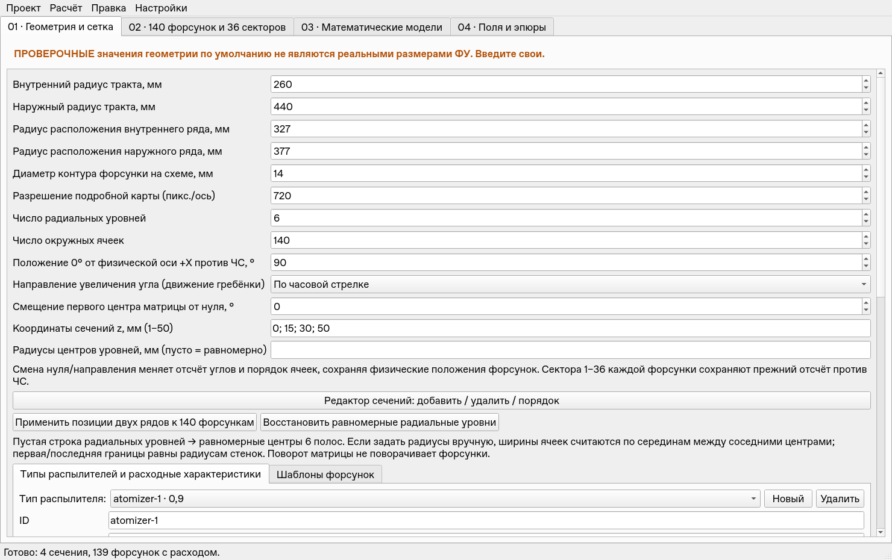
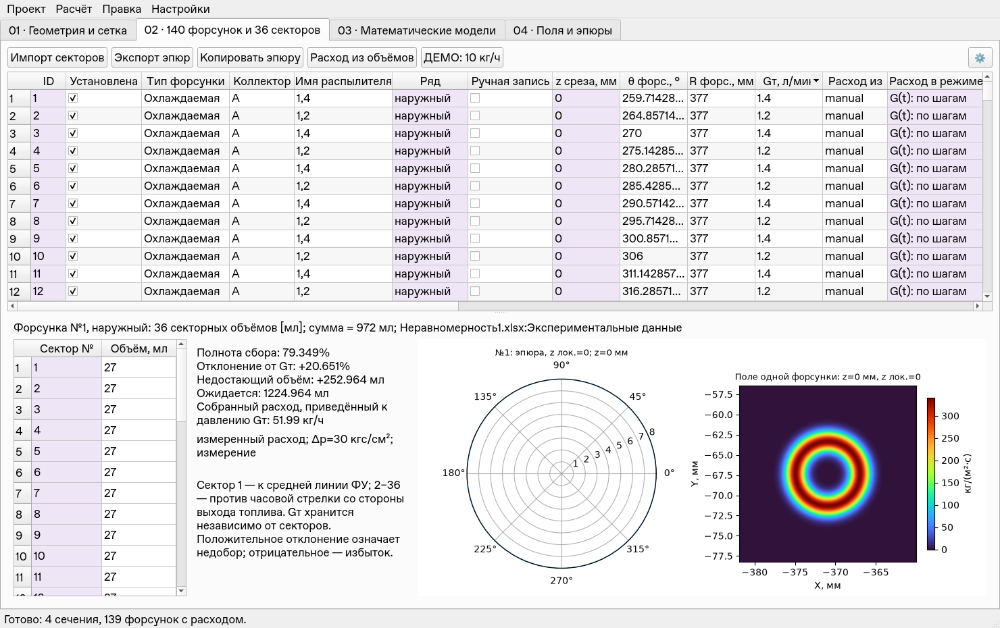
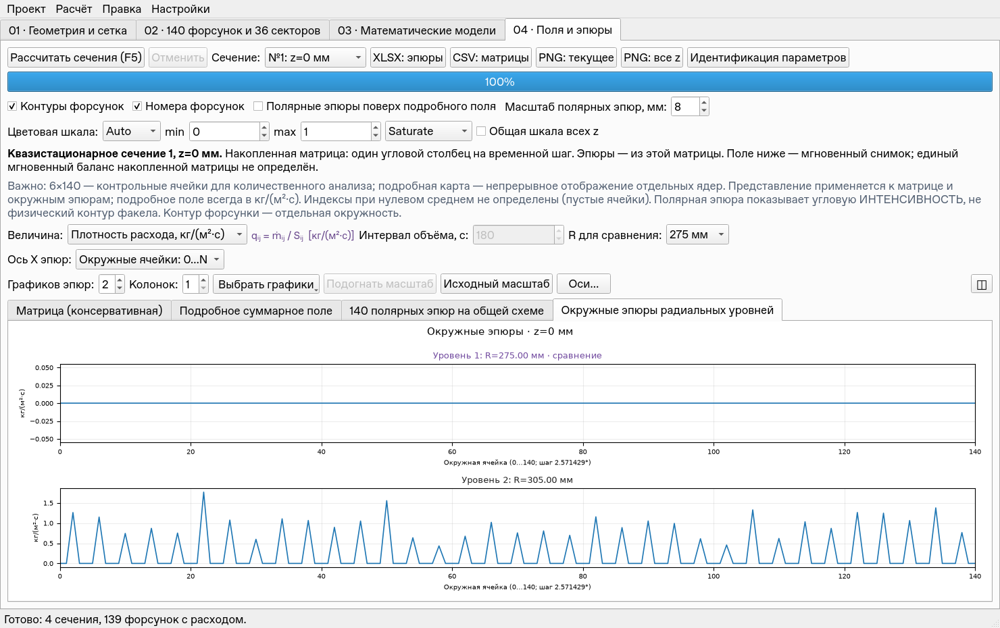

# v0.5.2 — восстановление десятичного ввода и системы измерительных углов

Четыре изменения внесены поверх актуального `main` **923ee96** («JSON Project»),
после принятия исправлений v0.5.2 через PR #15. Номер версии остаётся **0.5.2**.
Ветка: `codex/v0.5.2-coordinates`. Данные пяти пользовательских JSON из этого
коммита и `requirements.txt` не изменены. Сохранены графики давлений, кэш полей,
отложенные скрытые превью и оптимизации отклика предыдущей сборки.

## Как пользоваться

1. **Десятичный ввод.** Числовые поля показывают `1.23` вместо `1.230000…`.
   После запятой/точки можно сразу вводить цифры. Если дробная часть уже
   заполнила допустимую точность и заканчивается нулём, вставка цифры убирает
   последний незначащий ноль. Значащие цифры автоматически не удаляются.
   Поддерживаются точка и запятая. Открытие и закрытие редактора таблицы без
   правки сохраняет исходное число полной точности. Шаг ячеек остаётся 0.001,
   шкалы min/max — 0.0001; эти шаги не ограничивают точность ручного ввода.
2. **Ось X.** На 04 над настройками числа графиков есть список «Ось X эпюр»:
   градусы 0…360 либо окружные ячейки 0…N. При 140 ячейках координата
   `k=θизмер·140/360`: 0°, 2.571428571°, 5.142857143° соответствуют 0, 1, 2.
   Реальных измерений 140, с координатами 0…139; край 140 замыкает окружность
   и повторяет значение первого измерения. Переключение не меняет матрицу и
   не требует F5. Настройка сохраняется в проекте и поддерживает Undo/Redo.
3. **Система отсчёта на 01.** «Положение 0° от физической оси +X против ЧС»
   задаёт физическое место измерительного нуля. +X — вправо, 90° — вверх.
   «Направление увеличения угла» задаёт движение гребёнки по/против ЧС.
   Например, при нуле 90° и направлении по ЧС измерительные 10° находятся
   в физическом положении 80°. После изменения выполните F5.
4. **Таблица 02.** Начало таблицы: ID → Установлена → Тип форсунки →
   **Коллектор → Имя распылителя** → Ряд. Угол форсунки показывается и
   редактируется в системе 01. Смена системы сохраняет физическое положение
   форсунок; новое явно введённое значение угла меняет положение. При
   Auto-follow явная правка угла по-прежнему перестраивает оба ряда.







## Связь с квазистационарным режимом и файлами

Преобразование координат едино для стационарного и квазистационарного расчёта:

`θфиз=(θноль+d·θизмер) mod 360`, где d=+1 для против ЧС и −1 для по ЧС.

В окне режима «Первый угол» и автоматические углы таблицы — **измерительные**.
«Обход 01: Вперёд» означает увеличение измерительного угла в направлении,
выбранном на 01. «Обратно» означает противоположное движение. При нуле 90°,
по ЧС и N=140 шаги 0, 1, 2 физически находятся в 90°, 87.428571429°,
84.857142857°. К каждому из этих положений применяется давление соответствующей
строки времени. При нуле 0° и против ЧС оба варианта обхода полностью сохраняют
прежний смысл и результат старых `.quasi.json`.

Меняется порядок/состав контрольных ячеек, а не физическая геометрия форсунок
и не их 36 локальных секторов. Непрерывное мгновенное поле от изменения
отсчёта само по себе не меняется. Ползунок времени использует прежний кэш
влияний; подсказка показывает измерительный и физический угол. Матрица остаётся
накопленной по шагам, единый мгновенный баланс ей не приписывается.

JSON проекта сохраняет `theta_zero_deg`, `theta_direction`, `display_x_axis`.
Старые проекты без этих полей получают 0°, против ЧС, градусы. В JSON форсунки
`theta_deg` остаётся физическим углом от +X против ЧС. Отдельный `.quasi.json`
сохраняет характеристику давления и измерительные углы; систему отсчёта хранит
проект, поэтому при переносе характеристики проверьте 01.

В split эпюры второго JSON приводятся к системе основного проекта; его матрица
показывается в собственной системе. Для CSV/XLSX под списками X/Y есть
«Отсчёт X в файле»: абсолютный +X/против ЧС либо в системе проекта. Угловые
заголовки `angle_deg`, `theta_deg`, `theta_center_deg` или единицы `[°]`/`[deg]`
распознаются как градусы; `cell_index`, `measurement_index`, «номер ячейки» —
как координаты ячеек с числом N основного проекта. Остальные X, например
время, не преобразуются. Для Link нужны совместимые единицы и система отсчёта.

Численные экспорты сохраняют канонические физические `angle_deg`/`theta_deg`,
а XLSX также сохраняет настройки проекта. В квазистационарном отчёте
`scan_angle_deg` — измерительный угол гребёнки. Это позволяет повторно загрузить
экспорт с вариантом «Абсолютный». PNG эпюр использует выбранный вид оси.
В CSV номер `theta_node` по прежнему начинается с 1; это служебный номер
столбца, в отличие от нулевой координаты графика.

## Автоматические и визуальные проверки

До восстановления функций полный прогон исправленной v0.5.2 `0862379`:
**217 тестов, 102.537 с, OK**. Реализация основана на последующем пользовательском
`923ee96`. Окончательный полный прогон: **227 тестов, 103.643 с, OK**,
без пропусков. Из них десять новых проверяют:

- десятичный ввод в C/русской локалях, удаление незначащего нуля и сохранение
  значащих цифр, ввод в реальную ячейку таблицы и отсутствие округления без правки;
- перестановку столбцов при повороте/реверсе системы отсчёта, неизменность
  физических положений и непрерывного поля, массовый баланс;
- каждый временной шаг квазистационарной матрицы при ненулевом нуле и обходе
  по ЧС, со сравнением с независимым стационарным расчётом обоих коллекторов;
- JSON round-trip и совместимость старых файлов, недопустимые настройки;
- реальные контролы 01/04, локальную правку угла и Undo, неизменную матрицу
  после перехода в ячейки, split/Link по новой координате X;
- угловые/ячеечные/неугловые внешние X, порядок «Коллектор» и реальный щелчок
  по обоим заголовкам единиц расхода после перестановки столбцов.

Два прежних ожидания приведены к актуальным данным: новый порядок столбцов
вместо старых первых пяти; имя типа берётся из пользовательского каталога,
в котором «1,3» переименован в «1,4». Идентификаторы и численные проверки
сохранены, тесты не отключались.

Дополнительно проверены окна 1280/1480/1920×930 и настройки 1280×820. Ползунок
виден, высота подробного поля не менее 315 px; два графика давления помещаются
справа от таблицы. Снимки выше, [отчёт размеров](V0.5.2_COORDINATES_UI.json)
и [настройки давления](images/v0.5.2-coordinates/pressure_frame.png).

Пакетный расчёт копии актуального пользовательского проекта с нулём 90°, по ЧС,
ячейками и синтетической характеристикой двух коллекторов: четыре сечения,
16 PNG, CSV и XLSX; максимальная абсолютная относительная ошибка мгновенного
баланса шага 35 — **1.71e-13**. Исходный файл не перезаписывался.

## Отклик на актуальном пользовательском проекте

Linux offscreen, Python 3.12.14. Последовательные запуски отдельно от тестов:
140 позиций, 6×140, четыре z, поле 720², исходные синтетические давления A/B.
Штатные таймеры не отключались. Реальные действия QTest, пиксели QWidget,
60 кадров после 5 прогревочных, 32 переключения вкладок, 30 выходов из
неизменённого числового поля. Числа относятся к этой облачной машине.

| Действие | Прежний отсчёт 0°/против ЧС/градусы | Ноль 90°/по ЧС/ячейки |
|---|---:|---:|
| Ползунок, медиана / p95 | 27.450 / 28.391 мс | 27.869 / 28.956 мс |
| Ползунок, максимум | 30.146 мс | 32.437 мс |
| Повторное переключение вкладок, медиана / p95 | 8.989 / 9.673 мс | 9.116 / 9.998 мс |
| Выход без изменения поля, медиана / p95 | 0.234 / 0.279 мс | 0.251 / 0.379 мс |
| Полные redraw за серию ползунка | 0 | 0 |
| Расчёт и первичный показ | 3.956 с | 3.754 с |

Смена 0→35 изменила **2658 пикселей** Qt-поля; матрицы и проект после
навигации равны исходным. Серия 100 правок давления вызвала одно обновление
двух графиков за 195/219 мс, включая таймер 120 мс. После физической правки на
01 максимальная пауза Qt около 55 мс. Первое построение вкладки может занимать
до 101 мс; эти холодные действия не входят в медиану повторного переключения.
Здесь сравниваются два режима нового кода на **актуальном** пользовательском
проекте; это не повтор старого сравнения разных реализаций и старого JSON.

Отчёты: [обычная система](V0.5.2_COORDINATES_LATENCY.json),
[система 90°/по ЧС/ячейки](V0.5.2_COORDINATES_FRAME_LATENCY.json).

```bash
QT_QPA_PLATFORM=offscreen python -B -m unittest discover -s tests -v
QT_QPA_PLATFORM=offscreen python -B tools/benchmark_v052_ui.py \
  --frame-zero 90 --clockwise --cells --out /tmp/coordinate_latency.json
```

Windows/Spyder по указанию пользователя не проверялись.
