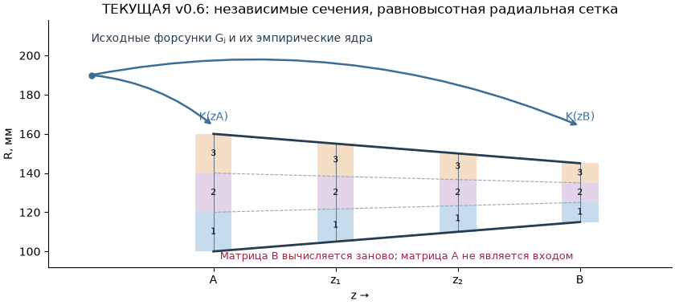
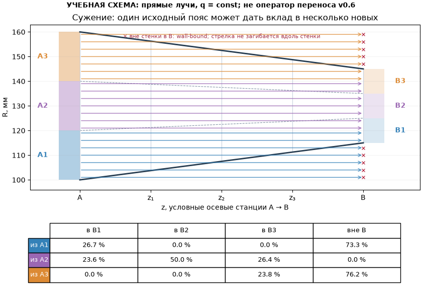
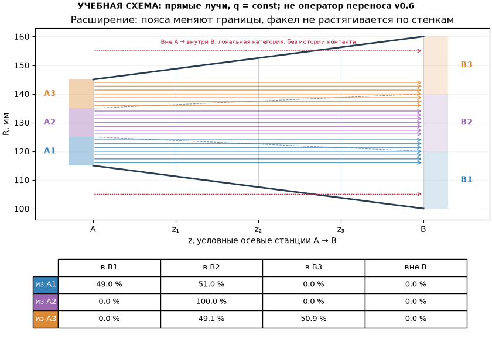

# v0.6.3 — геометрия кольцевой жаровой трубы

Версия добавляет геометрию и её связь с существующими топливными расчётами.
Координата **z=x [мм]** — прежняя осевая координата программы; нового поворота
или переноса начала оси не выполняется. R — расстояние до оси, θ — физический
угол от +X против часовой стрелки. Измерительный ноль/обход на 01 продолжает
преобразовывать углы таблицы 02 и измерительной гребёнки.

## Быстрый запуск

1. Откройте `examples/demo_project_v063_s_profile.json`. **Все** его геометрия,
   расходы, 36 секторов и давления синтетические; это не данные испытаний.
2. На 01 выберите **«Профили ЖТ: Sketcher и таблицы»**. Слева — Sketcher,
   справа — таблицы; ширина регулируется разделителем. В демо обе стенки
   содержат S-образное сужение из дуг, а наружный ряд имеет неравные угловые шаги.
   Отрезки фиксированы, дуги касательны к ним и друг другу; связи видны
   на странице «Связи».
3. Выберите примитив в таблице и измените размер. Подтвердите ввод Enter:
   корректная геометрия сразу отображается в Sketcher и входит в Undo/Redo.
   Маркер выбранного объекта получает приоритет над перекрывающимися маркерами.
4. На 04 выполните F5. Выберите сечение: радиусы стенок, поясов, площади и
   масштаб карты соответствуют именно его координате z.
5. **«Продольный вид ЖТ»** показывает профили, ручные сечения и рассчитанные
   радиальные значения. Можно выбрать среднее по окружности или одну ячейку.
6. Для проверки пульсаций включите квазистационарный режим в «Настройках».
   В демо уже записаны синтетические 140 шагов давления A/B; применять новый
   импорт не требуется. Закройте окно настройки и выполните F5. Ползунок под
   подробным полем меняет мгновенное поле; матрица остаётся накопленной.

## Старый проект и включение профилей

Старые JSON открываются со всеми прежними 140 ID, рядами, выключенными
форсунками, коллекторами, измерениями, типами и настройками. Пока галочка
**«Профили ЖТ»** снята, работает прежний постоянный тракт.

При первом открытии редактор предлагает постоянные отрезки Rin/Rout по старым
радиусам. Это исходный эскиз, а не новые измерения. Включение галочки применяет
этот эскиз. Постоянный профиль на прежней сетке воспроизводит старый расчёт.
При активной геометрии Rin/Rout и список z в старой форме защищены: меняйте
профили и сечения в новом редакторе. Снятие галочки возвращает сохранённые
legacy-настройки; редактируемый профиль остаётся в проекте.

## Примитивы и размеры

| Столбец | Назначение |
|---|---|
| ID | Новые примитивы: ВН1… (внутренняя), НР1… (наружная), ОП1… (опорная). Существующие ID проекта сохраняются, чтобы не разорвать ссылки. |
| Стенка | Внутренняя, наружная либо опорная геометрия. Опорные примитивы не ограничивают поток. |
| Тип | Точка, отрезок или круговая дуга. Сплайны отсутствуют. |
| z₁/R₁, z₂/R₂ | Координаты концов в единицах строки. Для точки нужен только первый конец. |
| z/R центра | Аналитический центр окружности. Изменение одной координаты переносит всю дугу на ту же величину. |
| Радиус | Новое значение перемещает центр, сохраняя оба конца и сторону изгиба. Минимум — половина длины хорды; меньший радиус диагностируется. |
| По ЧС | Направление от первого конца к второму в меридиональной плоскости z/R. Не направление обхода гребёнки. |
| Единицы | mm, cm, m. Смена единицы строки пересчитывает числа, сохраняя размеры. |
| Зафиксировать кривую | Флажок сразу после ID блокирует координаты, форму, перемещение, удаление и разбиение. Снимите его перед изменением. Смена единиц сохраняет физические размеры и остаётся доступной. |

Неприменимые и защищённые ячейки имеют мягкий фиолетовый фон. Числа допускают
точку и запятую. Вставка блока из буфера обрабатывается одной операцией Undo.
Неизменённые числа сохраняют полную исходную точность. При совместной вставке
концов, центра и радиуса приоритет имеют концы и явно введённый радиус — центр
пересчитывается. При вставке координат без радиуса он вычисляется из окружности.
Если ранее сохранённые центр/концы и радиус не согласованы, выберите дугу и нажмите
**«Согласовать дугу по радиусу»**. Не нужно переключать «Профили ЖТ» или стенку.
При радиусе меньше половины хорды или невозможном R(z) появится диагностика.
Ячейки, определяемые касательностью, также защищены и имеют поясняющую подсказку.

Отдельный профиль должен быть непрерывной однозначной функцией R(z) от базы
до выхода. Порядок строк не задаёт порядок обхода — примитивы упорядочиваются
по физической координате. Проверяются непокрытые интервалы, разрывы,
перекрытия/самопересечения, радиусы и положительный зазор **на всём профиле**.
Вертикальная касательная в конце дуги допустима, внутренний разворот по z — нет.

Дуги сохраняются как окружности. Параметр **«Хорда ≤, мм»** ограничивает стрелу
прогиба отображаемых отрезков. Расчёт радиусов и нормалей использует точную
окружность, а не экранную полилинию. **«Шаг, мм»** задаёт независимую сетку
геометрических станций для дальнейших расширений; он не добавляет расчётные
сечения и не запускает транспорт, которого в v0.6 нет.

## Мышь и сопряжения

- Перетащите конец отрезка/точку: координаты отразятся в таблице. Концы, соединённые явной связью,
  перемещаются вместе. Есть временное попадание в координаты соседнего конца
  при попадании в допуск около восьми экранных пикселей.
- Конец дуги свободно следует за курсором; противоположный конец остаётся на
  месте. Центр пересчитывается с сохранением углового размаха и направления дуги.
  Координаты всех маркеров и таблицы обновляются сразу, без общего сдвига выделения.
- Квадратный маркер центра либо сама линия дуги переносят дугу целиком. Движение
  свободное, без ограничения биссектрисой хорды. Для точного переноса задайте
  координату центра в таблице. Начало/конец также свободны по обеим координатам;
  если границы стенки перестали совпадать с базой/выходом, появится диагностика.
- «Разбить» делит выбранную линию/дугу на два аналитических примитива с общим
  концом. Их последующий связанный ввод сохраняет сопряжение.
- Колёсико масштабирует под курсором, средняя кнопка перемещает вид, «Вписать»
  показывает всю геометрию. Завершённое перетаскивание — одна Undo-команда.
- Список «Двойной ЛКМ» выбирает создание точки/линии/дуги/отверстия/вставки.
  Для линии и дуги задаются два конца двумя двойными щелчками. Новый примитив
  получает стенку из списка «Стенка новых примитивов» (по умолчанию опорная).
  Замените/сопрягите нужный участок вручную. Esc отменяет незавершённое построение.

Некорректная таблица остаётся **черновиком** с красной диагностикой и не
передаётся расчёту. Это позволяет согласовать несколько взаимосвязанных размеров.
Некорректное перетаскивание **остаётся видимым красным черновиком**, без возврата
под курсором. Исправьте размер либо нажмите «Сбросить черновик». Расчёт и
сохранение проекта используют последнее применённое состояние; перед уходом
из редактора устраните сообщение о черновике.
Изменение проекта в другом редакторе может заменить неподтверждённый черновик.

**Undo/Redo учитывает каждый завершённый шаг черновика**, даже когда профиль
пока не принят: один ввод ячейки, вставку блока, перетаскивание от нажатия до
отпускания мыши, создание/удаление связи. Кнопки ↶/↷, Ctrl+Z/Ctrl+Y и меню
работают с одной историей. «Сбросить черновик» тоже является шагом: нажмите
Ctrl+Z, чтобы вернуть именно сброшенный эскиз, включая его незавершённые размеры
и диагностику. Во время движения мыши отдельные кадры в историю не добавляются.
История действует в текущем сеансе программы; JSON сохраняет применённый проект,
не незавершённый черновик и не журнал Undo.

### Если профиль не принимается

- **«Дуга поворачивает по z»**: обход окружности прошёл через её крайнюю точку
  по z и вернулся назад. Часто концы и центр верны, но выбрана большая дуга
  вместо малой. Выберите строку и нажмите **«Исправить направление дуги»**:
  кнопка меняет только «По ЧС», только если альтернативный обход допустим;
  концы, центр и радиус остаются прежними. У реальной петли нельзя просто убрать
  проверку: модель требует единственного R для каждого z. Численная погрешность
  положения вертикальной касательной в пределах допуска теперь учитывается.
- **«Профиль должен покрывать базу…выход»**: проверьте первый и последний z
  каждой стенки, а не порядок строк. Выход равен самому дальнему сечению.
  Если стенки уже нарисованы до нового выхода, они принимаются без достройки
  и без изменения формы. Если не хватает конца, достраивается только недостающая
  часть. Разрыв между участками всё ещё надо соединить явно.
- **«Радиус не согласован»**: используйте «Согласовать дугу по радиусу» для
  намеренно заданного размера либо исправьте противоречивые координаты.

Сечения в неприменённом черновике теперь заканчиваются на **нарисованных
стенках**, а не на радиусах старого цилиндра. Если пересечение со стенкой
отсутствует или многозначно, линия этого сечения временно не рисуется;
это не подтверждение пригодности всего профиля к расчёту.

Сетка автоматически меняет шаг при масштабировании; её можно выключить.
Внизу эскиза показаны координаты курсора, вверху — выбранный ID. Круглые маркеры
обозначают концы, квадрат с крестом — центр. Радиус захвата маркера больше его
видимой части. При перекрытии объектов сначала выберите нужный ID в таблице.
После изменения размера окна «Вписать» возвращает весь профиль в рабочую область.
Последние столбцы широкой таблицы доступны горизонтальной прокруткой.

### Точки из XLSX

На странице «Примитивы» нажмите **«Точки XLSX…»**. Выберите лист, первую строку
данных, столбцы z и R, единицы mm/cm/m и принадлежность к стенке. Предпросмотр
показывает первые 200 строк, проверяются все строки. Разрешены десятичная запятая
и пустые строки; неполная пара, нечисловое/бесконечное значение, R≤0 или повторная
точка блокируют импорт с номером строки Excel. Формулы должны иметь сохранённый
численный результат (пересчитайте и сохраните книгу в Excel).

«Импортировать» добавляет отдельные опорные/стеночные точки одной операцией Undo.
Они не соединяются автоматически в профиль. Источник, лист, исходные единицы и
номер строки сохраняются в provenance. Отмена и ошибочный файл не меняют проект.
Синтетический пример: `examples/sketcher_points_v061.xlsx`.

## Связи: совпадение и касательность

### Совпадение точек

1. Нажмите **«Совпадение точек»** над эскизом.
2. Щёлкните по круглому маркеру перемещаемого конца первой кривой.
3. Щёлкните по маркеру конца второй кривой — точки назначения. Первая точка
   переместится ко второй; связанный конец дуги сохранит точную окружность.
4. На странице **«Связи»** появится C№. У связанных концов есть зелёная обводка.
   В дальнейшем изменение общей точки переносит все связанные с ней концы.

Если маркеры перекрываются, откройте **«Связи…» → «Совпадение…»** и выберите
ID и начало/конец в списках. Esc отменяет выбор. Простое совпадение координат
или временный захват около восьми пикселей не создают скрытую новую связь.

Для старых проектов прежние общие вершины одной стенки преобразуются в список
связей при первом редактировании. После этого удалённая связь не возникает
снова только потому, что концы пока находятся в одном месте.

### Касательность объектов: дуга–отрезок и дуга–дуга

Нажмите **«Касательность»**, затем щёлкните по линиям двух кривых, вдали от
общего маркера. Теперь выбираются **объекты**, а не две перекрывающиеся точки.
Существующее совпадение (в том числе через цепочку связей) определяет контакт;
если его нет, выбирается единственная ближайшая пара концов. Поэтому уже
установленное совпадение не мешает добавить касательность.

Для дуги и отрезка порядок выбора произвольный.
Отрезок сохраняет оба конца и получает флажок фиксации. Точка касания совпадает
с выбранным концом отрезка; противоположный конец дуги остаётся на месте.
Редактор точно вычисляет центр и радиус окружности, касательной к отрезку.
Обводка касания — золотистая. Изменяются параметры дуги, а не отрезок.

Для двух дуг **первая подгоняется ко второй, опорной**. У первой сохраняется
противоположный конец, вычисляются контакт, центр и радиус; геометрия второй
в этой операции остаётся прежней. Если первая зафиксирована, а вторая свободна,
роли автоматически меняются. Опорная дуга не получает фиксацию автоматически:
её можно редактировать, зависимая дуга снова подстроится. Для блокировки всей
геометрии опорной поставьте её флажок «Зафиксировать кривую». Возможны внешнее
и внутреннее касания окружностей, если результирующие дуги остаются R(z).

В окне **«Связи… → Касательность…»** также выбираются два объекта. При нескольких
общих концах или одинаковом расстоянии до двух контактов включите
«Указать контакт вручную» и выберите начало/конец. Редактор не угадывает контакт
в неоднозначном случае. Несовместимые циклы и несколько невыполнимых касаний
отклоняются; координаты закреплённых кривых не меняются ради подгонки.

Пусть P — контакт, Q — противоположный конец дуги, n — единичная нормаль
к отрезку. Тогда C=P+λn, где λ=|Q−P|²/[2(Q−P)·n], радиус R=|λ|.
При нулевом знаменателе конечная окружность невозможна. Несовместимые касания,
закреплённые точки или дуга с разворотом по z диагностируются; отрезок ради
подгонки не сдвигается. Если у дуги два касания, проверяются оба на одной
окружности. Это точный решатель перечисленных ограничений, не общий CAD-решатель.
Для опорной дуги n направлена по радиусу её окружности в контакте; та же формула
определяет окружность подгоняемой дуги.

Связь касательности включает совпадение контактных точек. Её нельзя сочетать
со свободным переносом всей дуги относительно закреплённого отрезка. Меняйте
свободный конец дуги: центр/радиус подстроятся, контакт сохранится. Для свободной
правки удалите касательность; защищённые ею поля снова станут редактируемыми.

### Удаление связей и фиксация

На странице **«Связи»** выделите строку C№ и нажмите **«Удалить связь»**.
Текущие координаты останутся прежними, последующие правки станут независимыми.
Удаление касательности освобождает её собственный контакт. Если дополнительно
существует отдельное совпадение тех же точек, оно остаётся в списке. При удалении
совпадения удаляется и касательность той же пары, чтобы не оставлять скрытой
привязки. Все действия входят в Undo/Redo и сохраняются в JSON.

Флажок **«Зафиксировать кривую»** расположен после ID в таблице примитивов.
Зафиксированную кривую нельзя переместить мышью, изменить через её соседа,
разбить или удалить. Несовместимое изменение связи отклоняется с ID кривой.
Для изменения сначала снимите флажок. Фиксация положения и связь — разные
ограничения: удаление связи само по себе не снимает флажок фиксации отрезка.

## Объекты

Таблица «Объекты» содержит все 140 ссылок `N1…N140` на исходные форсунки и
добавленные отверстия H1…, вставки I1… или пользовательские типы (первая буква
типа + номер). Новые группы имеют ID G1…; номера не перенумеровываются при удалении. ID форсунки и его
измерения остаются в основной записи `nozzles`; второй расходной копии нет.
Для отключения позиции используйте «Установлена» на 02, удалять ID нельзя.

| Поле | Что задаётся |
|---|---|
| Тип | nozzle, hole, insert или введённый пользовательский тип. |
| Стенка/примитив | Свободная позиция либо геометрическая привязка к участку стенки. Ссылка должна покрывать z объекта. |
| z/R/θ | Физические координаты в мм/градусах. Здесь θ глобальный; на 02 он показан в измерительной системе 01. |
| Группа | Выводится из списка участников группы. |
| Параметры JSON | Расширяемый словарь свойств; неизвестное значение оставляйте `null`. |
| Единицы JSON | Явные единицы свойств. Для стандартных ключей используются мм, градусы и кг/с. |
| Происхождение JSON | Источник, номер измерения/чертежа, `source_kind`, пояснения и пользовательские поля. |

Стандартные параметры: `inclination_deg` — наклон к локальной нормали,
`azimuth_deg` — азимут подачи, `flow_kg_s` — известный массовый расход,
`penetration_mm` — проникновение/высота вставки. Неизвестный расход **не**
равен нулю. Эти свойства хранятся для будущих моделей; отверстия/вставки пока
не добавляют воздух, не отклоняют факел и не меняют топливный расход.
Нормаль стенки определяется аналитически, при угловом стыке — выбранным
примитивом. Наклон подачи не заменяет существующий эмпирический угол факела.

Для объекта на стенке R вычисляется как Rстенки(z)+`radial_offset_mm`;
сохранённый `radius_mm` свободного положения при такой привязке не используется.
При явной привязке форсунки её исходная координата синхронно меняется, а после
правки стенки следует за ней. Остальные свободные форсунки остаются на месте.
Правка R привязанной форсунки на 02 меняет отступ от стенки. Несогласованная
запись привязки/координат в JSON диагностируется, а не исправляется молча.

«Вид по окружности» показывает реальные X/Y и позволяет двигать объект по θ.
Радиус и z при этом сохраняются; выбранный объект связан со строкой таблицы.

## Угловые группы

Выделите нужные объекты и добавьте группу. Без выделения предлагаются свободные
участники наружного ряда. Члены перечисляются стабильными ID через `;`.
Объект не может входить сразу в две группы.

| Режим | Ввод |
|---|---|
| Равномерно | N углов с шагом 360/N. |
| Индивидуальные углы | N относительных углов через `;`. |
| Массив шагов | N положительных шагов через `;`, включая замыкающий; сумма 360°. |

Итоговый угол: `θ=(фаза+смещение_ряда+d·относительный_угол) mod 360`;
d=+1 против ЧС, −1 по ЧС. Проверяются количество и повторы после нормализации.
Фаза и смещение ряда позволяют задавать чередование/шахматную расстановку.
Правильная правка группы сразу изменяет положение её объектов.

При группах используется ручная глобальная расстановка: старый Auto-follow
всех 140 позиций не перезаписывает неравномерные группы. Если угол участника
изменён отдельно на 02 или в Sketcher, группа становится индивидуальной с
фактическими углами. Расходы, коллекторы, сектора и ID при этом сохраняются.

## Сечения, пояса и баланс

Таблица **«Расчётные сечения»** задаёт координаты расчёта матриц/полей.
Новые ID — S№; порядок строк и имеющиеся имена сохраняются. **Выход ЖТ равен
максимальному z сечений**, а не последней строке таблицы. Метка выхода
вычисляется автоматически. Поле «Выход, мм» переносит самое дальнее сечение;
новое значение должно оставаться правее остальных срезов.

Правка внутреннего сечения не меняет стенки. При добавлении/переносе среза за
прежний выход редактор достраивает каждую стенку новым отрезком по касательной
к её последнему участку. Все прежние координаты и R(z) до старого выхода
сохраняются, в том числе фиксированные кривые. Это явная операция построения,
не измеренные данные: provenance новых линий содержит `extend_outlet_tangent`
и исходный ID. Проверьте продолжение и при необходимости замените его своей
геометрией. Для вертикальной касательной такое продолжение невозможно —
редактор просит вручную подготовить следующий участок, а не выдумывает радиус.

При сокращении выхода незакреплённые стенки обрезаются на новом z по прежним
аналитическим линиям/окружностям. Связи удаляемых участков убираются той же
операцией Undo. Если сокращение затрагивает зафиксированную кривую, оно
отклоняется до снятия фиксации. Оставьте хотя бы одно расчётное сечение.

При переменных стенках N поясов равны **по высоте**, N по умолчанию 6:

`Rj(z)=Rin(z)+j·(Rout(z)−Rin(z))/N`.

Площадь ячейки `A=Δθ·(Rj+1²−Rj²)/2` с радиусами в метрах. Площади разных
радиальных поясов различаются. В постоянном режиме сохраняются и старые
пользовательские радиальные центры. Для переменного профиля применяются
равновысотные пояса; старые произвольные центры остаются в legacy-настройках.

`inside + inner + outer + wall_bound = injected` для каждого **мгновенного**
сечения. При переменных стенках `inner/outer=0`, всё вне локального тракта
относится к `wall_bound`; `wall_inner/wall_outer` — его подкатегории, их не
нужно повторно прибавлять. Внутренний поток не перенормируется.

### Допущение wall-bound: что именно рассчитывается сейчас

wall-bound — **массовый расход вне локальных стенок выбранного осевого
сечения**, в кг/с (при выводе в кг/ч умножается на 3600). Это не запас топлива
на стенке в кг и не плотность потока в кг/(м²·с).

Для каждого z берётся исходный эмпирический факел каждой включённой форсунки,
находящейся перед сечением. Его нормированные пространственные веса несут
расход G_j, определённый характеристикой и текущим перепадом давления. Геометрия
не перенормирует факел под размер тракта. Элементы этого распределения
классифицируются по своему радиусу r именно в рассматриваемой плоскости:

| Положение элемента | Категория |
|---|---|
| r < Rin(z) | `wall_inner` — за внутренней стенкой |
| Rin(z) ≤ r < Rout(z) | `inside` — в кольцевом тракте, распределяется по ячейкам |
| r ≥ Rout(z) | `wall_outer` — за наружной стенкой |

`wall_bound = wall_inner + wall_outer`. Численная квадратура суммирует веса
без удаления внешних частей. Матрица хранит только inside; плотность потока
ячейки получается как её массовый расход / точная площадь ячейки. Внешнее топливо
не «добавляется обратно» и не разносится по ближайшим ячейкам.

Для мгновенного переменного профиля выполняется:

`G_injected = G_inside + G_wall_bound`.

В полях результата `inner`/`outer` при этом равны нулю; `wall_inner` и
`wall_outer` — подкатегории wall_bound, повторно прибавлять их не надо.
Например, из 100 кг/ч 82 попали в тракт, 5 — внутрь внутреннего радиуса, 13 —
наружу наружного. Получаем inside=82 и wall_bound=18, баланс 100. Сумма
82+5+13+18 была бы двойным учётом. При постоянном legacy-тракте сохранены
прежние названия outside-категорий `inner`/`outer` и прежняя численная модель.

**История контакта не отслеживается.** Для каждого следующего z факел снова
сопоставляется с локальными Rin/Rout независимо. Поток, отнесённый к wall-bound
в одном сечении, может оказаться внутри более широкого тракта ниже по течению.
Это следствие локальной геометрической классификации; его нельзя называть
физическим отрывом плёнки или подтверждённым возвратом капель. Первый удар,
осаждение, отражение, плёнка, стекание, испарение, задержка и перенос вдоль стенки
сейчас не моделируются. Наклон/кривизна стенок меняют локальные границы и площади,
но не искривляют эмпирические факелы и не уменьшают расходы форсунок.

Такой расчёт полезен для проверки геометрического охвата факелами и доли
неразрешённого топлива, сравнения формы тракта и оценки качества самой модели.
Большая доля wall-bound означает, что существенная часть расхода находится вне
области, для которой показана матрица. По ней нельзя предсказывать массу плёнки,
потери топлива, температуру стенки или итоговую температуру газа. Корректный
первый контакт и дальнейший перенос требуют отдельной модели v0.7, измерений
или CFD для проверки; текущую категорию нельзя использовать как её замену.

В квазистационарном режиме этот баланс проверяется **для каждого мгновения**
с давлениями соответствующего шага. Итоговая матрица собрана из угловых столбцов
разных мгновений; у неё нет одного G_injected и единого мгновенного wall-bound.
Показатель для всей такой матрицы не следует интерпретировать как одномоментный
баланс. Пользуйтесь отчётом отдельных шагов; ползунок поля показывает выбранный
мгновенный снимок.

У составной квазистационарной матрицы по-прежнему нет единого мгновенного
баланса. Отдельные балансы всех шагов находятся в отчёте. CSV стационарной
переменной геометрии создаёт соседний `*_balances.csv`; XLSX содержит `Balances`.
Плотность потока кг/(м²·с), расход кг/с и масса кг не взаимозаменяемы.

## Сужение и расширение: как читать вклад радиальных поясов

### Что рассчитывает программа

На сетке меридионального сечения вертикали — осевые станции, а линии между
стенками — границы равновысотных поясов. Пояс №1 всегда ближайший к внутренней
стенке. При изменении высоты канала его границы изменяются: одинаковый номер
пояса в A и B **не означает одинаковый диапазон R**. Границы сетки — не линии
тока и не траектории капель.

Для каждого z программа вычисляет `q(z)=Σ Gⱼ Kⱼ(z)`. Затем относит точки
численной квадратуры к местным радиальным/угловым ячейкам. **Матрица A не
передаётся на вход расчёта B**. Нет операции `G_B = T · G_A`, где T содержала бы
доли каждого исходного пояса в следующем. Из двух готовых матриц такую T
однозначно восстановить нельзя: разные распределения траекторий дают одни и
те же суммарные расходы в ячейках. Координаты и веса ядра пересчитываются при
каждом z; даже одинаковые индексы квадратуры нельзя считать одними частицами.

Поэтому сужение меняет площади и долю попадания факела внутрь стенок, но не
сжимает сам факел по высоте; расширение не растягивает его. Плотность `q=G/A`
может измениться из-за площади и из-за изменения G в ячейке. Сравнивайте
одновременно расход [кг/с], площадь [м²] и плотность [кг/(м²·с)].

### Учебные стрелки: вклад каждого исходного пояса

Следующие две схемы показывают **условную геометрическую модель для объяснения**,
не действующий оператор переноса. Допущения примера: один угловой сектор,
стационарность, равномерная по площади плотность потока, строго осевые прямые
лучи `R=const`, без новых источников между A и B. Три пояса выбраны для
читаемости; для шести принцип тот же. Цвет стрелки — исходный пояс A1/A2/A3;
подпись справа — пояс B, куда этот луч попал бы. Число стрелок само по себе
не является весом: площади кольцевых полос различны.

Для этих **заданных учебных допущений** доля из пояса Ai=[a,b] в Bj=[c,d]:

`Tji = max(0, min(b,d)² − max(a,c)²) / (b² − a²)`.

Если интервалы не пересекаются, доля равна нулю. Колонка «вне B» дополняет
строку до 100%. Общий множитель Δθ/2 сокращается. При неоднородном q вместо
разности квадратов потребовался бы интеграл q по соответствующему пересечению;
при наклонных/искривлённых траекториях одной площади пересечения недостаточно.

**Сужение 100…160 → 115…145 мм.** В A пояса 100–120, 120–140, 140–160 мм,
в B — 115–125, 125–135, 135–145 мм.

- A1 даёт 26,7% в B1, остальное за внутренней границей B.
- A2 даёт 23,6% в B1, 50,0% в B2 и 26,4% в B3.
- A3 даёт 23,8% в B3, остальное за наружной границей B.

Красный крест показывает положение вне локального канала B. Стрелки не
загибаются вдоль стены и не перераспределяются между оставшимися ячейками.
Для физического удара и дальнейшего движения нужна отдельная модель.

**Расширение 115…145 → 100…160 мм.** Теперь A1=115–125, A2=125–135,
A3=135–145 мм; B1=100–120, B2=120–140, B3=140–160 мм.

- A1 делится между B1 и B2; A2 целиком попадает в B2.
- A3 делится между B2 и B3. Исходный расход в этом учебном примере сохраняется.
- Пунктирные красные стрелки показывают радиусы, находившиеся вне A, но внутри B.
  Текущий локальный расчёт может показать там inside, заново вычисляя исходный
  факел. Он не доказывает физический возврат топлива со стенки.

В действующей версии нельзя получить таблицу измеренных/рассчитанных вкладов
Ai→Bj: такой перенос не вычисляется. Для него потребуются отдельный закон
движения, история контакта со стенкой, учёт всех источников и проверка баланса
между станциями. Здесь схемы объясняют отличие локальной сетки от транспортной
модели; топливное ядро v0.6 не заменено учебными коэффициентами.

## Сохранение и совместимость

Формат проекта остаётся `fuel-field-pilot-v1`, схема проекта теперь 2,
версия программы 0.6.3. Старые проекты со схемой геометрии 1 открываются без изменения. При первом
редактировании со связями/фиксацией `settings.geometry` получает схему 2 и хранит
аналитические примитивы, ручные сечения, объекты, группы и пользовательские типы.
Неизвестные вложенные поля сохраняются; неподдерживаемые будущие схемы
отклоняются с диагностикой. Старый редактор v0.6.1 не откроет геометрию схемы 2: это защищает связи и фиксацию от незаметной потери.
Для дуга–дуга используется та же структура связей схемы 2; v0.6.2 явно
отклоняет такую неподдерживаемую пару, не удаляет её молча.

Большие настройки XLSX делятся на части в листе `Metadata`, поэтому JSON
геометрии не обрезается лимитом одной ячейки Excel. Численные углы экспорта
остаются физическими от +X против ЧС. Для split CSV/XLSX используйте уже
существующий выбор системы отсчёта X.
