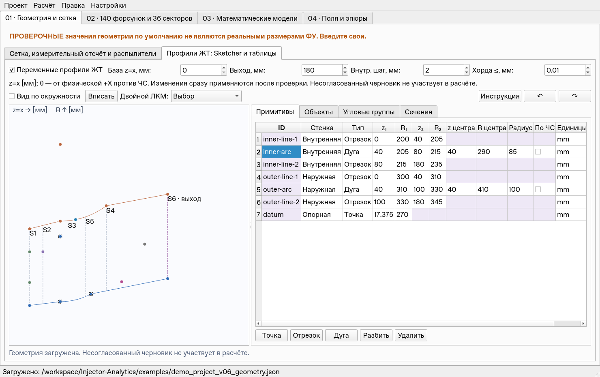
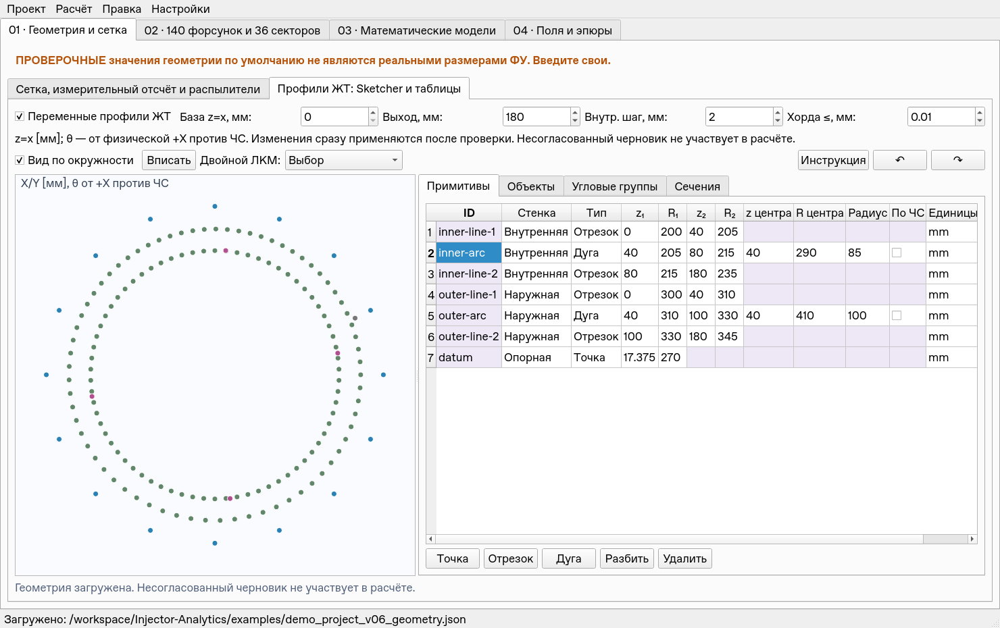
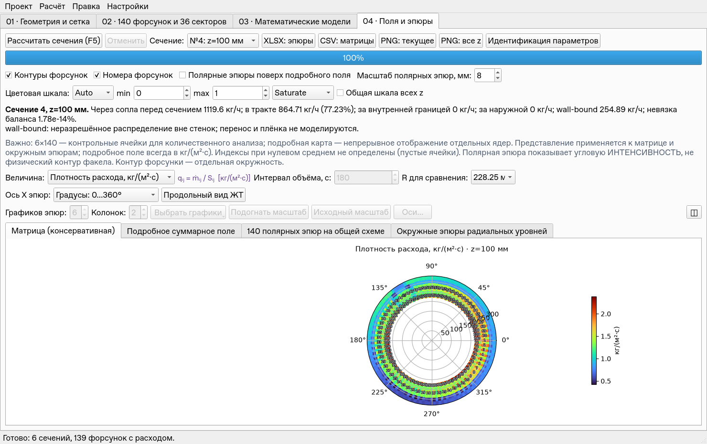
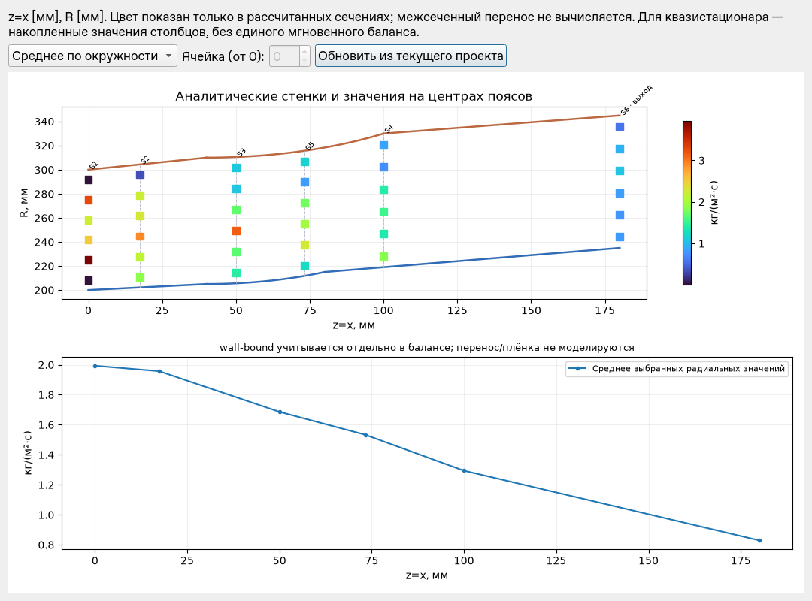
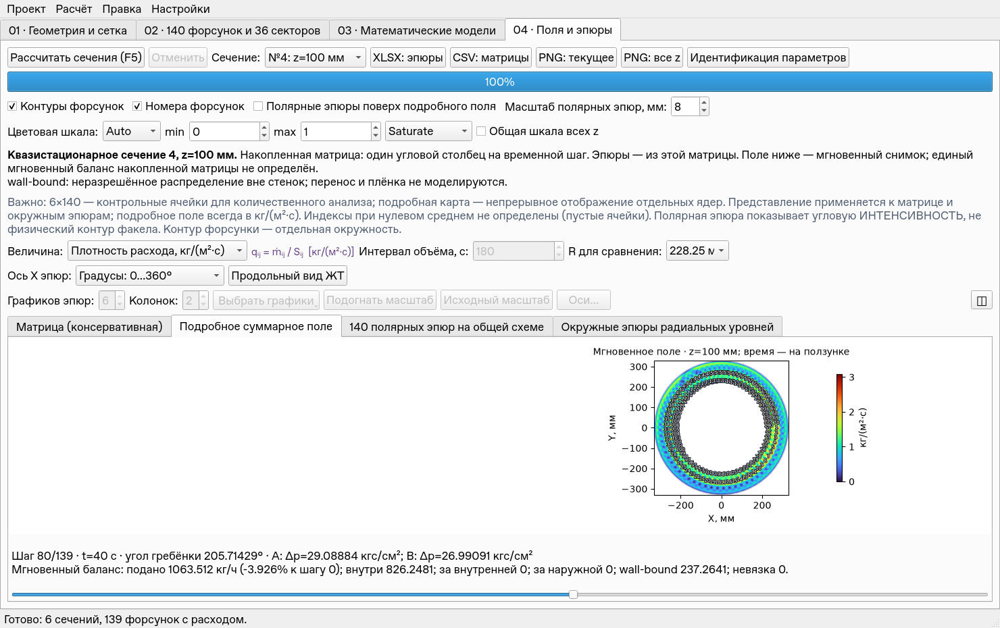

# v0.6.0 — реализация и проверка приёмки

Основа: `main` **dfac6cda72b1311100b99f15a108e8f5490bca9d**,
версия 0.5.2, после принятия спецификации v0.6. Implementation-ветка
`codex/v0.6`; main не изменяется и PR автоматически не сливается.
Инструкция: [V0.6_GUIDE.md](V0.6_GUIDE.md).

## Реализация

- `chamber.py`: аналитические точки/отрезки/дуги, единицы, независимые стенки,
  непрерывность/однозначность, строгий зазор, сетка поясов, объекты/группы/привязки.
- `chamber_gui.py`: общий валидируемый черновик Sketcher и таблиц, ручные размеры,
  создание/drag, выбор, snap концов, zoom/pan, атомарная вставка, общая Undo-история.
- `chamber_plotting.py`: профили и значения на физических координатах рассчитанных
  сечений; отдельно указано, что межсеченный перенос не моделируется.
- Core/quasi: локальные границы и площади, сохранённые эмпирические ядра и
  давление по каждому шагу; отдельный wall-bound без скрытой перенормировки.
- Схема проекта 2, схема raw-геометрии 1, прежний format сохранён. Неизвестные
  вложенные записи и исходные 140 форсунок остаются источником данных.
- `demo_project_v06_geometry.json` воспроизводится `tools/create_v06_example.py`.
  Обе стенки с линиями/дугами, 140 позиций (139 включены), 21 дополнительный
  объект, неравные шаги, фазовое смещение, шесть ручных сечений с выходом.
  **Все его размеры, расходы, сектора и давления синтетические.**

Основные изменения разбиты на проверяемые коммиты: `7859156` — математическое
ядро/миграция/баланс; `cd42206` — связанные редакторы, привязки, demo и UI-тесты.
`44347ce` — отклик геометрического редактора, стабильные размеры графиков и
дополнительные регрессии быстрых путей.

## Тесты

Среда: Linux, Python 3.12.14, PyQt5 offscreen, NumPy/Matplotlib/SciPy из
зафиксированной среды. Runtime-зависимости не менялись. `requirements-dev.txt`
добавляет OpenPyXL для независимой проверки XLSX тестами; приложению он не нужен.
`pip check`: конфликтов нет. Windows/Spyder по указанию пользователя не проверялись.

| Прогон | Результат |
|---|---|
| До изменений на dfac6cd | 227 тестов, 126.789 с, OK |
| Первый общий после ядра и миграций | 271 тест, 151.191 с, OK |
| Новые математические/миграционные/UI/экспортные проверки вместе | 73 теста, 23.159 с, OK |
| Промежуточный общий до оптимизации UI | 300 тестов, 177.617 с, OK |
| Все новые проверки после оптимизации | 78 тестов, 19.506 с, OK |
| Итоговый полный прогон | **305 тестов, 150.200 с, OK**, без пропусков |

В одном предварительном полном прогоне на 300 тестах не успела сработать
цепочка двух 120-мс Qt-таймеров за фиксированные 350 мс. Изолированный повтор
прошёл; тест переведён на ожидание результата с пределом 1 с. Проверки **ноль
расчётов в серии выделений / ровно один после / повторное использование /
время выделения** сохранены. Это изменение ожидания теста, не ослабление
дебаунса программы; итоговый полный прогон после него проходит.

Команды:

```bash
python -m pip install -r requirements-dev.txt
QT_QPA_PLATFORM=offscreen MPLCONFIGDIR=/tmp/injector-mpl \
  python -B -m unittest discover -s tests -v
QT_QPA_PLATFORM=offscreen PYTHONPATH=src:tests \
  python -B -m unittest test_chamber_math test_v06_migrations test_v06_gui test_v06_exports -v
```

## Независимый аудит

По AGENTS.md выполнены три независимых аудита. Аудиторы меняли только свои
тесты; найденные дефекты исправлялись в основной реализации.

- **Математика, 33 теста.** Четверть/полуокружности и смена направления,
  точность хорды, касательные/нормали, масштаб/единицы/перенос, экстремумы,
  непокрытые интервалы, порядок примитивов, полный межстеночный зазор,
  площади, группы, точное legacy-совпадение и stationary/quasi баланс.
  Каждая колонка переменного давления сравнивается с независимыми
  стационарными расчётами двух коллекторов при нестандартном нуле/обходе.
- **Миграции, 20 тестов.** Восемь старых проектов разных версий, все ID и
  исходные измерения/коллекторы, unknown-поля и отсутствие общих изменяемых
  ссылок JSON, снимки/Undo, привязки, stale-data сценарий 02→геометрия→save,
  индивидуальные/групповые углы, отказы будущих/неправильных схем, XLSX-части.
- **UI, 21 тест.** Настоящий ввод через делегаты и мышь, один Undo на drag,
  точка/центр дуги/концы/форсунка, выбор туда/обратно, создание двойным ЛКМ,
  некорректный черновик, единицы, общий конец, 140-членная группа, ручные
  сечения/обязательный выход, native save/open, splitter, zoom/pan,
  физический продольный просмотр и окно 1280×800. Дополнительно проверены
  сохранение объектов сцены при числовой правке без загрузки скрытых редакторов,
  обновление привязанного объекта/линий и подписей сечений, сброс ошибочного
  черновика при повторном открытии того же проекта.
- **Дополнительно, 4 теста.** Комплектность/синтетический статус demo, баланс
  всех его ручных сечений и площади, CSV-категории и одна Undo-команда для
  вставки двух строк; неизменность размеров кэшированных графиков и отсутствие
  их повторной Matplotlib-отрисовки при переключении короткого/длинного баланса.

Обнаружены и закрыты: медленное дробление зазора почти параллельных линий,
привязка вне диапазона примитива, alias корневых unknown-полей, перекрытие
выбранного маркера другим, устаревшие данные форсунок во втором редакторе,
неявный z-override при правке метаданных, невалидный реестр типов и
согласованность геометрических привязок с каноническими координатами,
устаревшие маркеры сечений, несброшенный черновик при повторном открытии и
изменение высоты графиков из-за переноса текста баланса.

## Таблица критериев приёмки

| Критерий спецификации | Фактический результат |
|---|---|
| Независимые стенки, z=x, фиксированный θ | Реализовано; аналитическое вычисление и явное преобразование измерительного отсчёта |
| Точка/линия/точная дуга, размеры/единицы | Реализовано; без сплайнов и без CAD-решателя |
| Валидация по всему профилю | Реализовано; экстремумы разности R вычисляются аналитически, включая касания между сечениями |
| Sketcher рядом с таблицей, общий источник | Реализовано; splitter, общие ID и валидируемый черновик |
| Изменение в обе стороны, выбор, Undo/Redo | Пройдено реальными Qt-действиями; один drag/вставка = одна команда |
| Ручные сечения и обязательный выход | Пройдено; порядок и точные координаты сохраняются |
| Независимая внутренняя сетка | Реализован интерфейс геометрических станций; не подменяет ручные сечения и не выдаётся за транспорт |
| N равновысотных поясов и правильные площади | Пройдено; по каждому z, N по умолчанию 6, сумма площадей = площадь кольца |
| Объекты, типы, свойства, единицы, provenance | Реализовано; неизвестные значения null, дополнительных физических источников не возникает |
| 140 форсунок и коллекторы | Сохранены; свободные позиции не перемещаются при миграции |
| Привязка к стенке/примитиву | Реализовано; явная привязка синхронизирует координату, проверяет интервал и отступ |
| Равные/индивидуальные/неравные углы, фаза/ряды | Пройдено, включая нормализацию/повторы/сумму 360° и редактирование в схеме |
| Legacy при постоянных стенках | Матрицы/площади/поля численно совпадают, в том числе пользовательские радиусы и quasi |
| Баланс inside/inner/outer/wall-bound | Пройдено; подкатегории wall-inner/wall-outer не прибавляются второй раз |
| Composite без фиктивного мгновенного баланса | Пройдено; общий баланс не определён, на шагах проверяется отдельно |
| Версионирование/unknown/дуги/groups round-trip | Пройдено на старых и новых JSON, future-schema отклоняется |
| Дитякин/сектора/давления/цвета/экспорт/регрессия | Все прежние тесты в итоговом прогоне проходят; регрессия проверяет радиальную сетку по каждому z |
| Продольный профиль/поля | Реализовано на физических координатах ручных сечений, без изображения несуществующего переноса |
| Demo и инструкция | Поставлены, кнопка инструкции внутри редактора |
| Отклик и большие группы | Измерения ниже; 140 форсунок и дополнительная группа 1000 объектов отдельно от физических источников |
| Windows | Не выполнялось; не выдаётся за пройденный smoke |

## Численные допуски и физические ограничения

Геометрическое сопряжение/положительный зазор проверяются с допуском **1e-7 мм**.
Для нормировки пространственных влияний предел **1e-12**, для мгновенного
quasi-баланса — **1e-11**; интеграционные тесты используют фактически более
строгие ошибки. Постоянные профили проверяются на точное совпадение массивов;
для одинаковой равновысотной сетки, созданной двумя арифметическими формами,
допускаются rtol 1e-13 / atol 1e-16 для площадей.

wall-bound в v0.6 — категория **вне локальных стенок на данном z**, а не
прослеженный первый контакт/плёнка. Пересечение раньше сечения, движение по
стенке и возвращение в тракт не моделируются. Эмпирические факелы v0.5.2 не
подменяются новым законом. В наклонах/отверстиях сохранены входные свойства,
но они не создают пока воздух/смешение/температуру. Для composite нет единого
мгновенного баланса. Полноценный CAD constraint solver не разрабатывался:
несогласованные размеры пользователь исправляет в диагностируемом черновике.

План v0.7–v0.8 уточнён в [roadmap](ROADMAP_v0.6-v0.8.md); его физика не
реализована скрыто в v0.6. Незавершённых обязательных кодовых критериев нет;
внешняя публикация PR и ограничения платформы описываются отдельно при сдаче.

## Производительность и визуальная проверка

Замеры выполняются последовательно отдельно от тестов. Числа относятся к
этой Linux offscreen машине, не являются обещанием для Windows.
Сравниваются одинаковый актуальный пользовательский проект 6×140, четыре z,
720² и одинаковая синтетическая характеристика A/B:
[baseline](V0.6_UI_LATENCY_BEFORE.json),
[итоговый замер](V0.6_UI_LATENCY_FINAL.json).

| Пользовательский проект, один сценарий | Baseline v0.5.2 | v0.6 итог |
|---|---:|---:|
| Worker + начальный рисунок, мс | 4857.5 | 4621.1 |
| Ползунок, медиана / p95, мс | 30.04 / 35.04 | 28.67 / 29.89 |
| Прогретые вкладки, медиана / p95, мс | 11.02 / 13.74 | 10.46 / 11.08 |
| Неизменённый контрол, медиана / p95, мс | 0.303 / 0.463 | 0.277 / 0.346 |
| Физическая правка, синхронная часть, мс | 93.84 | 69.48 |

В итоговом тесте ползунок изменил **2524 настоящих пикселя Qt** и не вызвал
ни одной полной Matplotlib-отрисовки. Навигация не меняет исходный JSON или
расчётные матрицы. Вставка 100 давлений обновляет два графика одним пакетом.

Первый холодный замер v0.6 дал 7431.5 мс worker+render
([сохранён](V0.6_UI_LATENCY_AFTER.json)); он не замалчивается и не сравнивается
с прогретым ядром. Отдельный последовательный контроль с одинаковым BLAS,
одним прогревом и тремя повторами: [до](V0.6_ENGINE_BEFORE.json) **3515.1 мс**,
[после](V0.6_ENGINE_AFTER.json) **3585.5 мс**, отличие около 2% при разбросе
отдельных повторов 3326–4069 мс. SHA-256 всех composite-массивов совпадает
**побайтно**; максимальная относительная невязка в обоих случаях 1.72e-13.

Подробные замеры редактора и нового demo:
[до оптимизации](V0.6_GEOMETRY_LATENCY.json),
[промежуточные](V0.6_GEOMETRY_LATENCY_OPTIMIZED.json),
[итоговые](V0.6_GEOMETRY_LATENCY_FINAL.json).

Для числовой правки перестали пересоздаваться 140 строк объектов и скрытые
гидравлические графики; обновляются изменённые примитивы и связанные объекты.
При переключении сечений зарезервирована высота под самый длинный баланс:
раньше перенос текста менял размер canvas и провоцировал повторный draw
кэшированного графика. Исправления проверены UI-тестами, а не отключением
таймеров или замерами подменённой функции.

| Синтетический demo v0.6 | До оптимизации | Итог |
|---|---:|---:|
| Правка ячейки геометрии, медиана / p95, мс | 277.10 / 338.22 | 59.44 / 96.18 |
| Кадр drag, медиана / p95, мс | 0.240 / 0.314 | 0.304 / 0.714 |
| Завершение drag + одна Undo-команда, мс | 319.68 | 57.92 |
| Прогретое переключение 6 сечений, медиана / p95, мс | 11.0 / 304 | 8.15 / 9.99 |
| Ползунок переменного тракта, медиана / p95, мс | 26.24 / 29.40 | 26.17 / 27.76 |

Первое открытие Sketcher — 195.84 мс. Первый рисунок ещё не посещённого
сечения требует **351–433 мс** создания Matplotlib-графика; эти холодные визиты
записаны отдельно, их нельзя выдавать за 8 мс. Последующие 24 переключения:
максимум 11.44 мс. Полный worker + первый рисунок всех шести сечений:
1854.15 мс стационарно и 4636.86 мс quasi. Здесь «всех сечений» означает
расчёт всех шести, а первично отрисовывается только выбранное.
Ползунок изменил 8320 пикселей; матрицы остались неизменными. Максимальная
мгновенная относительная невязка 8.94e-16.

Отдельная нагрузка: 140 форсунок + 1021 дополнительный объект, в том числе
группа 1000 отверстий. Один полный commit с первой отрисовкой — **763.03 мс**.
Это холодное построение большого редактора, а не задержка каждого drag-кадра;
интерактивное создание тысячи объектов одной операцией ещё заметно пользователю.
Проверены размеры 1280, 1480, 1920 пикселей: оба соседних редактора доступны,
таблицы имеют прокрутку. Скриншоты получены из настоящих Qt-виджетов.

Команды:

```bash
QT_QPA_PLATFORM=offscreen python -B tools/benchmark_v052_ui.py \
  --out /tmp/v06_ui_after.json
QT_QPA_PLATFORM=offscreen python -B tools/benchmark_v06_geometry.py \
  --out /tmp/v06_geometry.json
OPENBLAS_NUM_THREADS=1 python -B tools/benchmark_v06_engine.py \
  --out /tmp/v06_engine.json
```






