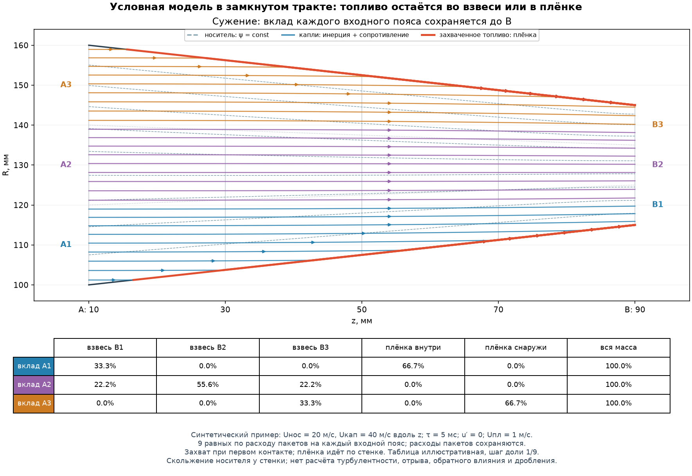
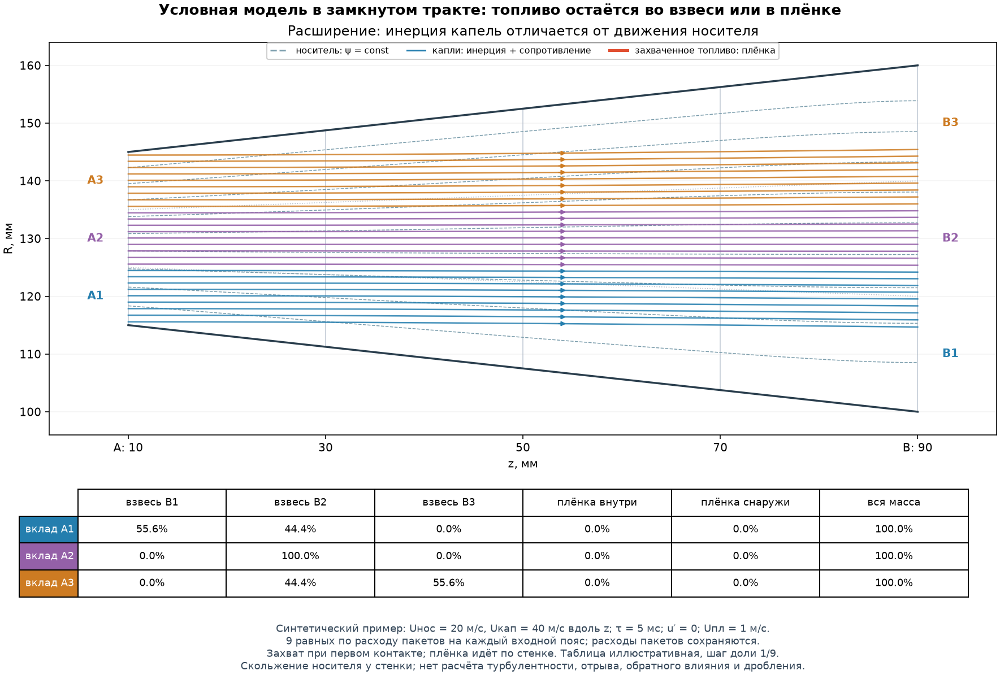

# v0.7: проверенные источники и замыкание переноса топлива

[Открыть инструкцию по параметрам и результатам](V0.7_GUIDE.md).

Этот обзор отделяет прочитанные источники от выбранных допущений. Задача —
сохранять вклад всех форсунок при последовательном движении через
профилированную жаровую трубу. Измеренных скоростей капель, дисперсности,
газового поля и турбулентных характеристик пока нет; пользователь подтвердил,
что параметры модели должны задаваться явно. Полученные ниже линии условны
относительно этих параметров. Однозначно восстановить реальное турбулентное
течение по геометрии, расходу и 36 секторам форсунки нельзя.

## 1. Что делала исходная программа

Проверены `sample_kernel()` и `calculate_plane()` в `src/fuelfield/core.py`
исходной v0.6.3, а также пояснения `docs/V0.6.3_VALIDATION.md`. В каждом
запрошенном z программа заново строила пространственное ядро форсунки,
классифицировала его относительно локальных стенок и считала матрицу.
Матрица предыдущего сечения не была входом следующего. Одинаковые индексы
квадратуры не задавали сохраняющиеся частицы. Локальная категория
`wall-bound` обеспечивала бухгалтерский баланс, но не определяла место и
время контакта, последующую скорость, плёнку или повторное увлечение.

Поэтому форсунка с радиусом установки меньше нового Rmin не должна просто
исчезать из выходного расчёта. Должна сохраняться её история: топливо ещё
находится во взвеси либо уже передано другой учитываемой фазе. Это требует
нового оператора переноса, а не нормировки оставшейся части старого ядра.

## 2. Какие материалы действительно прочитаны

### Дитякин, Клячко, Новиков, Ягодкин, 1977

**Ю. Ф. Дитякин, Л. А. Клячко, Б. В. Новиков, В. И. Ягодкин.
«Распыливание жидкостей». Москва: Машиностроение, 1977. 208 с.**
Использован DjVu, предоставленный пользователем. Ранее предложенные адреса
[страницы книги](https://djvu.online/file/c3yZ5f8AH6CGB) и
[скачивания](https://djvu.online/download2/c3yZ5f8AH6CGB) не используются как
доказательство сетевого доступа: прочитан именно загруженный файл.

Проверены титульные сведения и сохранённые распознанные фрагменты страниц
DjVu 112–118, 160–182, 204–209; технический текст цитируется ниже только по
указанным содержательным страницам. Сохранённый общий файл OCR оказался
пустым, поэтому полного электронного поиска по монографии не было.
Распознавание формул местами ошибается. Печатная с.116 дополнительно
проверена визуально по изображению, включая номер страницы и формулы
(103)–(105); их коэффициенты в новый модуль не переносились.

| Где искать в книге | Соответствие в данном DjVu | Что прочитано и что следует |
|---|---|---|
| §14, печатные с.113–118 | страницы файла 113–118; совпадение номера 116 проверено по изображению, остальные номера читаются в OCR | Соударение струй и образование плёнки, частные схемы с непроницаемой плоскостью симметрии, удар круглой струи о жёсткую плоскую стенку. Модель плёнки зависит от режима и постановки. Это не универсальный закон для распылённого топлива на криволинейной стенке. |
| Печатные с.160–163 | страницы файла 160–163, номера в OCR | Разные статистические диаметры и распределения капель. Один измеренный расход не задаёт распределение размеров. |
| §21, печатные с.164–176 | страницы файла 164–176, номера в OCR; на 172 OCR искажает номер | Влияние скорости истечения, относительной скорости газа, свойств жидкой/газовой фаз и геометрии на дисперсность. У эмпирических зависимостей ограниченная область применимости. |
| §22, печатные с.180–182 | страницы файла 180–182, номера в OCR | Дробление капли газовым потоком зависит от относительной скорости, поверхностного натяжения, размера, вязкости и длительности воздействия. Фиксированное время релаксации не описывает изменение размера при дроблении. |

Это сопоставление относится к фактически извлечённым страницам данной копии,
а не к произвольному изданию или общему смещению всех страниц файла.
Книга подтверждает необходимость различать капли, газ и плёнку. Она не
предоставляет в прочитанных разделах готового решения взаимодействующих
турбулентных факелов в произвольном кольцевом профиле с телами и рециркуляцией.

### Проверяемые реализации OpenFOAM Foundation

Фактически скачаны и прочитаны следующие исходные тексты ветки `master`
OpenFOAM-dev; ответ HTTP 200 и размеры сохранены в локальных журналах доступа.
Это первичные источники о реализации конкретных моделей, а не отчёт об их
валидации для данной камеры. SHA-256 прочитанных файлов и URL сохранены в
[журнале источников](V0.7_SOURCE_ACCESS.json), поскольку `master` изменяется.

1. [potentialFoam.C](https://github.com/OpenFOAM/OpenFOAM-dev/blob/master/applications/solvers/potentialFoam/potentialFoam.C).
   В описании прямо указан потенциальный поток и подготовка начального поля
   для решателей Навье–Стокса. В коде решается уравнение Лапласа для потенциала,
   корректируется поток через грани. Это основание различать потенциальное
   поле и решение турбулентного течения; `potentialFoam` не делает первое
   автоматически вторым.
2. [SphereDragForce.C](https://github.com/OpenFOAM/OpenFOAM-dev/blob/master/src/lagrangian/parcel/submodels/Momentum/ParticleForces/Drag/SphereDrag/SphereDragForce.C)
   и [заголовок](https://github.com/OpenFOAM/OpenFOAM-dev/blob/master/src/lagrangian/parcel/submodels/Momentum/ParticleForces/Drag/SphereDrag/SphereDragForce.H).
   Коэффициент линейного по относительной скорости сопротивления содержит
   вязкость газа, плотность и квадрат диаметра капли; коэффициент сопротивления
   зависит от Re. В просмотренной реализации `CdRe = 24(1 + Re^(2/3)/6)` при
   Re ≤ 1000 и `CdRe = 0.424 Re` выше. Следовательно, постоянное τ — отдельная
   эффективная аппроксимация, а не восстановленное по расходу свойство капли.
3. [StochasticDispersionRAS.C](https://github.com/OpenFOAM/OpenFOAM-dev/blob/master/src/lagrangian/parcel/submodels/Momentum/DispersionModel/StochasticDispersionRAS/StochasticDispersionRAS.C)
   и [заголовок](https://github.com/OpenFOAM/OpenFOAM-dev/blob/master/src/lagrangian/parcel/submodels/Momentum/DispersionModel/StochasticDispersionRAS/StochasticDispersionRAS.H).
   Используются поля k, ε, время жизни вихря и случайная скорость с масштабом
   √(2k/3). Эта модель не является процессом Орнштейна–Уленбека. Наше задание
   СКО и времени корреляции не воспроизводит RAS и не вычисляет k, ε.
4. [LocalInteraction.C](https://github.com/OpenFOAM/OpenFOAM-dev/blob/master/src/lagrangian/parcel/submodels/Momentum/PatchInteractionModel/LocalInteraction/LocalInteraction.C)
   и [заголовок](https://github.com/OpenFOAM/OpenFOAM-dev/blob/master/src/lagrangian/parcel/submodels/Momentum/PatchInteractionModel/LocalInteraction/LocalInteraction.H).
   Различаются `escape`, `stick`, `rebound`; для отскока отдельно меняются
   нормальная и касательная скорости. Вариант `stick` останавливает частицу,
   но сам по себе не решает транспорт стеночной плёнки. Наличие этих вариантов
   показывает, почему контактный закон нельзя вывести только из баланса массы.

В заголовке `SphereDragForce.H` есть ссылка на Amsden, Butler, O'Rourke,
*The KIVA-II computer program for transient multidimensional chemically
reactive flows with sprays*, SAE Technical Paper, 1987. Оригинал этой работы
не получен и не прочитан; это **вторичная библиографическая ссылка**, не
самостоятельно проверенный источник данного обзора.

Исходники OpenFOAM лицензированы GPL. В новый оператор не переносились их
фрагменты кода; выше описаны проверенные постановки, формулы и ограничения.

### Что получить не удалось

NASA Turbulence Modeling Resource, NASA NTRS, OpenAlex, документация
`doc.cfd.direct`, поиск arXiv и сайт Stephen Pope не открылись в данной среде:
CONNECT 403. Это ограничение доступа здесь, а не утверждение об отсутствии
научных работ. Статьи о confined turbulent jets по этим маршрутам не прочитаны;
их результаты, коэффициенты, графики и точность не приписываются нашей модели.
Непроверенные названия и DOI не добавляются для видимости полноты обзора.

## 3. Математическое замыкание, допустимое при имеющихся данных

### 3.1. Носитель, удовлетворяющий непроницаемости стенок

Принимается стационарный осесимметричный несжимаемый безвихревой **условный
носитель** в канале `Ri(z) ≤ r ≤ Ro(z)`. Это выбранное приближение. Оно задаёт
поле для однонаправленного воздействия на капли, а не рассчитывает горение,
реальное газораспределение, турбулентную струю или отрыв на расширении.

Вводится функция тока ψ:

```text
u_z = (1/r) ∂ψ/∂r,            u_r = −(1/r) ∂ψ/∂z,
div((1/r) grad ψ) = 0.
```

Первое определение тождественно даёт
`∂u_z/∂z + (1/r) ∂(r u_r)/∂r = 0`. Второе уравнение следует из нулевой
азимутальной завихрённости: `ψ_zz + ψ_rr − ψ_r/r = 0`.
На внутренней стенке `ψ = 0`, на наружной `ψ = Q/(2π)`;
`Q = U_in π(Ro_in² − Ri_in²)`. На входе
`ψ = U_in (r² − Ri_in²)/2`, на выходе — естественное условие `∂ψ/∂z = 0`.
Внутри формул координаты в метрах, `ψ` имеет размерность м³/с; публичный
интерфейс геометрии принимает миллиметры.

Слабая форма `∫(1/r) grad ψ·grad w dA = 0` решается линейными треугольными
элементами на сетке между стенками. Постоянство ψ вдоль стенки означает
нулевой нормальный расход носителя. Поток между любыми двумя ψ-линиями равен
`2π Δψ`, включая сужение и расширение. Отдельные равновысотные радиальные
ячейки не обязаны переноситься одна в одну.

Безвихревое поле имеет скольжение у стенки. Оно не даёт пограничного слоя,
отрыва, обратного течения и турбулентного перемешивания. Проверка
непрерывности и баланса такого поля не является проверкой соответствия
действительной турбулентной ЖТ.

### 3.2. Инерция топлива и фиксированные расходные веса

Каждому пакету источника j назначается постоянный расходный вес
`w_jp ≥ 0`, причём `Σ_p w_jp = G_j` в кг/с. Пакет проходит через
последовательность внутренних осевых станций; его состояние содержит
координату, скорость и фазу. Пакеты исходят из заданных мест форсунок.
Секторы определяют распределение **расходных весов** источника, но сами по
себе не определяют скорость истечения и распределение диаметров.

Для капель принимается явная эффективная релаксация:

```text
dx/dt = v,
dv/dt = (u(x) + u′(t) − v)/τ,       τ > 0.
```

В приближении Стокса для изолированной сферической капли
`τ = ρ_l d²/(18 μ_g)`. Это ограниченная малая-Re оценка: при конечном Re
сопротивление нелинейно, а при изменении размера меняется и τ. В текущей
постановке τ задаётся пользователем; диаметр и газовые свойства не
выдумываются. Предел малой τ означает близкое следование носителю, большой
τ — большую сохранность исходной скорости до контакта со стенкой.

Необязательная поперечная флуктуация — самостоятельное редуцированное
замыкание, с заданными СКО σ и временем корреляции T:

```text
du′ = −u′ dt/T + sqrt(2 σ²/T) dW.
```

Эта запись для каждой выбранной компоненты имеет стационарную дисперсию σ².
При σ = 0 случайное воздействие отсутствует. Она не предсказывает
характеристики турбулентности и не тождественна проверенной реализации
OpenFOAM `StochasticDispersionRAS`.

### 3.3. Первый контакт и отдельная плёночная фаза

Траектория проверяется на первый контакт с точной стенкой, в том числе
между запрошенными выходными сечениями. При выбранном законе `capture_film`
весь вес коснувшегося пакета передаётся стеночной плёнке, сохраняет ID
форсунки и дальше движется по той же стенке с заданной положительной
скоростью `U_film` вдоль касательной к профилю. Координата контакта важна:
позднейшее расширение не возвращает уже захваченное топливо во взвесь.

В численном операторе контакт определяется пересечением отрезка между
концами внутреннего шага с аналитической стенкой. Стенка задана точно,
а ломаная траектории аппроксимирует решение ОДУ; значения внутри шага
также интерполируются. Поэтому нужна сходимость по осевому шагу, даже
при машинно точном сохранении расходных весов.

Полный захват и постоянная скорость плёнки — **явно заданные допущения**.
Они не определены экспериментом и не следуют из одного лишь сохранения
массы. Не рассчитываются толщина плёнки, касательное напряжение газа,
гравитационный сток, расплескивание, испарение, повторный срыв и вторичное
дробление. Формулы удара цельной круглой струи о плоскость из книги Дитякина
не переносятся без проверки на отдельные капли и криволинейную стенку.

### 3.4. Что именно сохраняется и что означает матрица

Для любого осевого сечения после ввода всех рассматриваемых источников:

```text
G_источники = G_взвесь(z) + G_плёнка_внутр(z) + G_плёнка_наруж(z).
```

При наличии источников ниже по потоку справа учитываются только уже
введённые расходы. Веса не удаляются при выходе пробного отрезка за стенку,
не исчезают при `R_форсунки < Ri(z)` и не восстанавливаются нормировкой
оставшейся взвеси. Контакт меняет фазу и скорость, сохраняя расходный вес.
Время прохождения капли и плёнки различается; квазистационарная привязка
давления ко времени измерения остаётся отдельной постановкой, а не
автоматическим решением всех нестационарных двухфазных процессов.

Для взвеси матрица представляет осевой массовый расход через кольцевые
ячейки; площадь ячейки `A = Δθ(r_out² − r_in²)/2`. При отображении **полной**
матрицы вклад плёнки помещается в соответствующую граничную ячейку, но
сохраняет отдельный фазовый баланс. Это численная проекция поверхностного
расхода, а не утверждение о равномерной концентрации плёнки во всей
граничной ячейке. Сравнение взвеси и полной матрицы имеет разный физический
смысл; последующая тепловая модель должна выбирать фазовый вклад явно.

Изменение импульса капель учитывает сопротивление и стенку. Для стационарного
расходного веса изменение потока импульса `w Δv` имеет единицы
`кг/с × м/с = Н`, **не Н·с**. Противоположные реакции носителя и стенки
необходимо хранить в балансе сил/потока импульса. Заданное поле носителя не
изменяется от этих реакций: это однонаправленная модель разбавленного
распыла, а не замкнутое совместное решение импульса обеих фаз. Поэтому
отчёт о реакциях не следует называть доказательством полного двухстороннего
сохранения импульса всей камеры.

## 4. Перерисованные схемы и их проверка

Сохранена геометрия исходных учебных схем v0.6.3: станции A=10 мм и
B=90 мм. При сужении границы поясов A `[100,120,140,160]` мм переходят в
B `[115,125,135,145]` мм; при расширении — наоборот. Серый каркас —
равновысотная расчётная сетка, пунктирные голубые линии — вычисленные
`ψ = const` носителя. Цветные линии — **другие линии**, инерционные
траектории топлива. Красная линия после контакта — плёнка.





Входы здесь синтетические: `U_in = 20 м/с`, `V_inj = 40 м/с` строго
вдоль z, `τ = 0.005 с`, `U_film = 1 м/с`, `σ = 0`. Это распределённый
учебный вход по поясам, **не замена точечных источников 140 форсунок**.
В каждом поясе выбрано 9 равных по расходу пакетов по серединам равных
кольцевых площадей. Числа в таблице имеют дискретность 1/9 и служат
пояснением переноса, не оценкой точности или результатом испытаний.

Носитель взят из действующего `carrier.py`; траектории иллюстрации
вычислены отдельным малым детерминированным генератором с шагом 0.2 мм,
экспоненциальной релаксацией при фиксированном поле на шаге и первым
пересечением прямолинейной стенки. Генератор не заменяет тесты runtime
оператора. Скорость плёнки задаёт время движения, но не меняет её
геометрическую линию на стационарном рисунке.

В сужении из A1 и A3 по 6/9 расхода оказывается на соответствующей стенке,
по 3/9 остаётся во взвеси. A2 даёт в B1/B2/B3 доли 2/9, 5/9, 2/9.
В расширении плёнка при этих входах не возникает; A1 и A3 попадают в два
соседних пояса, A2 остаётся в центральном. Все строки вместе с плёнкой
дают единицу с ошибкой не более `2.23·10⁻¹⁶`.

Воспроизводимый генератор:
[tools/create_v07_schematics.py](../tools/create_v07_schematics.py).
Сохранены [SVG сужения](images/v0.7/narrowing-transport.svg),
[SVG расширения](images/v0.7/widening-transport.svg),
[точные входы и по-пакетный баланс](images/v0.7/schematic-inputs-and-ledger.json).
Изображения проверены визуально: читаемы подписи A/B, стрелки, различие
носителя/топлива/плёнки и фазовые столбцы таблицы; линий потери массы за
пределами стенки нет. Figma по последнему решению пользователя не требуется.

## 5. Что потребуется для следующих физических расширений

Для обоснованного прогноза смешения нужны измеренные/проверенные скорость
истечения, распределение размеров, газовые свойства и расход воздуха,
граничные условия по входам, а также данные для оценки турбулентности и
контактного закона. Калибровка по одной выходной эпюре не гарантирует
идентифицируемости: разные τ, угловое распределение и турбулентное
перемешивание могут давать похожий результат.

Для тел и зон затенения одного запрета прохода частиц через поверхность
недостаточно. Нужны обходное поле носителя, контактный закон, возможный
отрыв и след за телом; в реальном течении они могут быть трёхмерными.
Осесимметричное потенциальное поле не должно выдаваться за разрешённую
турбулентную зону затенения. Подвод воздуха также требует уравнения
непрерывности с источниками, входного импульса и замыкания смешения;
к текущему безисточниковому полю его нельзя просто добавить изменением
цвета матрицы. Для плотного распыла необходимо обратное влияние капель
на газ; для высоких We — дробление и изменение диаметра. Эти ограничения
задают границу применения текущего параметризованного оператора.
