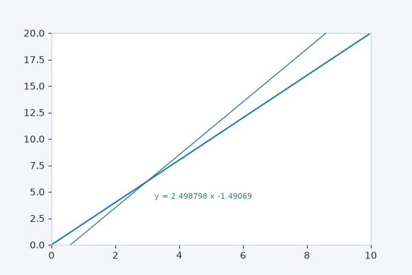
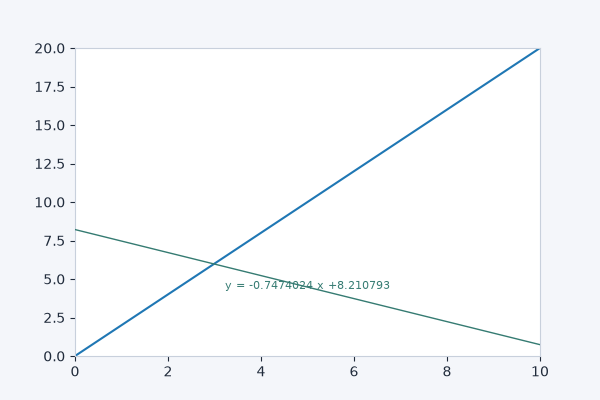
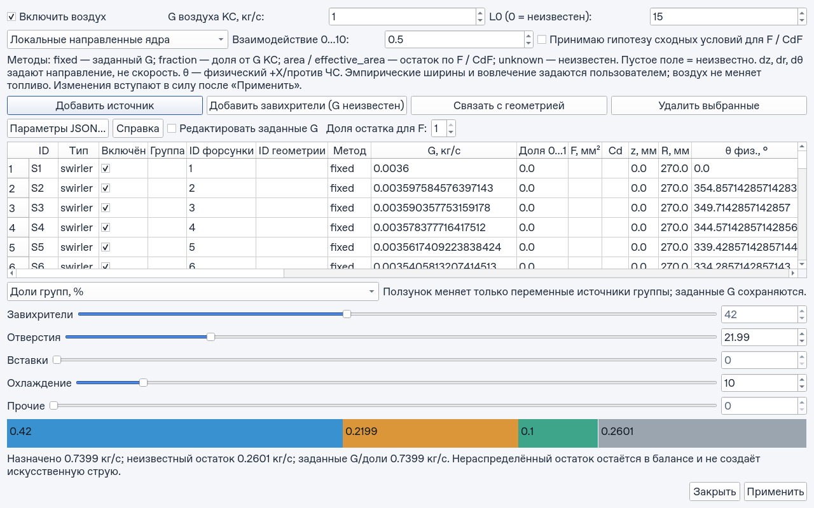
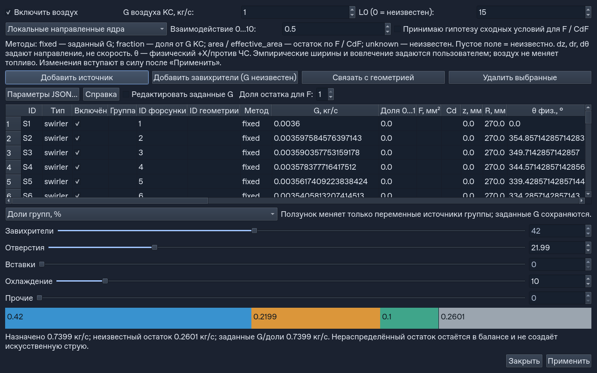
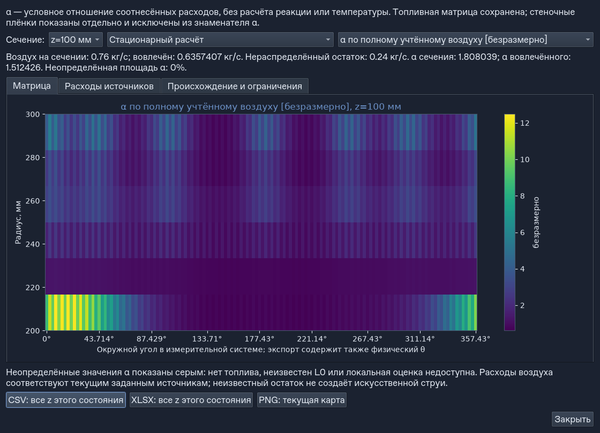
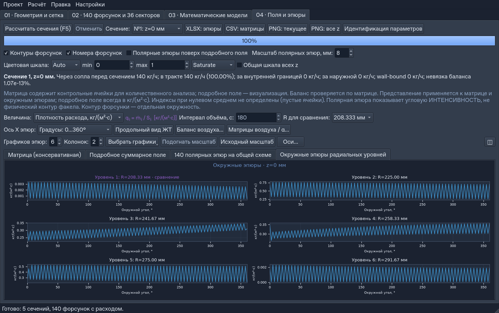
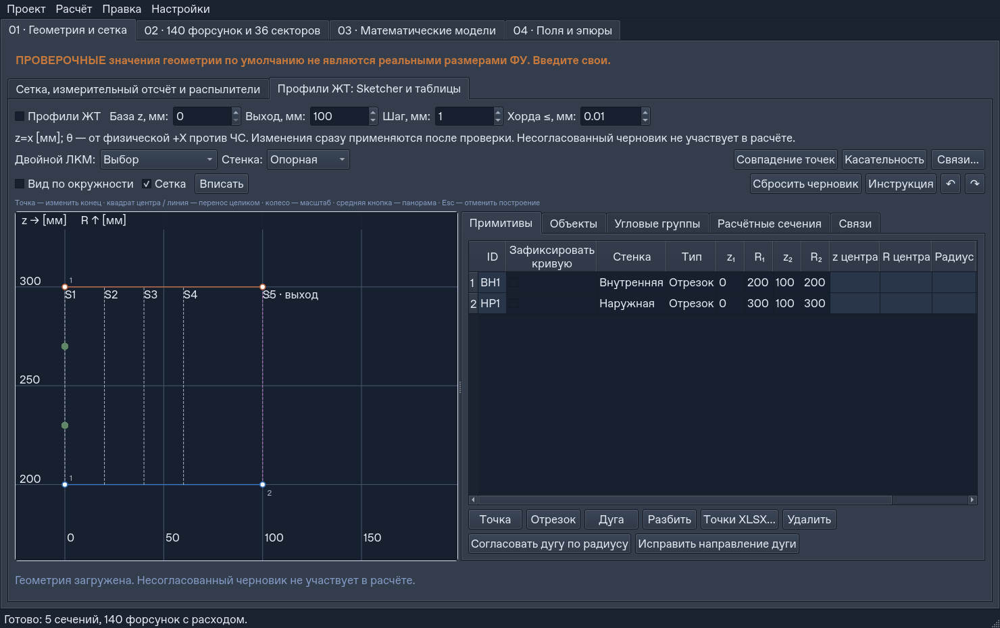

# Проверки v0.8.4: воздух, расходный α и интерфейс

Дата: 27.10.2026. Ветка `codex/v0.8-air-alpha`, PR #26.
База — `427dbfedb187065a4835c8c7f88d3fb4ce30ecad` (актуальный main после
согласования документации). Исходный код v0.7 в этой базе совпадает с
`944f1f9`; следующие коммиты до 427dbfe меняли только документацию.
Полный прогон 632 тестов подтвердил исправление lifecycle на `cefb150`.
Окончательные исходники: `e8c5654` (добавлено сохранение допустимого
коэффициента взаимодействия 0…10; 10 проверок миграции / 1.356 с / OK).
Main не менялся, PR автоматически не сливается.

## Что проверено

Новая подсистема рассчитывает расходный бюджет и условное пространственное
распределение воздуха, отдельно от топлива. Векторное замыкание — эмпирическая
модель, не CFD или физически подтверждённый баланс импульса. Формулы, единицы,
граничные случаи и пределы: [реализованная модель](V0.8_IMPLEMENTED_MODEL.md).
Пользовательская инструкция: [V0.8_GUIDE.md](V0.8_GUIDE.md).

| Прогон | Результат | Условия |
|---|---|---|
| Независимый baseline main | **547 тестов / 545.790 с / OK**, 0 FAIL/ERROR/SKIP | Изолированный `git archive 427dbfe`, те же зависимости |
| Полный финальный v0.8 | **633 теста / 712.827 с / OK**, 0 FAIL/ERROR/SKIP; полный набор по модулям, 2 процесса | Каждый модуль в новом процессе; ни один тест не исключён |
| Новая подсистема до заключительных расширений | 74 теста / 94.620 с / OK | Математика, миграции, UI, export и жизненный цикл |
| Крайние значения, редактор, настоящий перезапуск темы | 14 тестов / 5.617 с / OK | Относительный допуск малых бюджетов, точность ввода, Apply/Undo, два процесса QSettings |
| Matplotlib 3.8 + NumPy 1.26, финальные правки | 25 тестов / 45.069 с / OK | Матрицы/экспорт, численные пределы, редактор/миграции |
| Python 3.13, до последних правок | 21 тест / 64.657 с / OK | Qt drag/Undo/темы, результат/экспорт, Hide/destruction |
| Python 3.13, финальные правки | 15 тестов / 104.403 с / OK | Lifecycle, 400 таблиц, диапазон редактора/миграции, restart темы |

Прогоны выполнялись в отдельных сессиях. Их длительности не используются
как сравнительный benchmark; замеры рабочих сценариев приведены отдельно ниже.

Монолитный прогон 633 тестов на `e8c5654`: **632 PASS, 1 FAIL / 1334.727 с**.
Падений процесса нет. Единственный FAIL — прежняя проверка сохранения/загрузки
и worker с фиксированным ожиданием 20 с; изолированный повтор прошёл за 8.356 с.
В `6a67b94` только тестовое ожидание приведено к 120 с, как у native v0.7;
проверки результата, отсутствия ошибок и баланса сохранены.
Финальный полный набор автоматически обнаруживает все 633 теста и запускает
каждый модуль в новом процессе с отдельным QSettings, максимум два параллельно:

```bash
QT_QPA_PLATFORM=offscreen OPENBLAS_NUM_THREADS=1 \
python -B tools/run_test_shards.py --jobs 2 --out /tmp/v08-all-tests
```

Команда монолитного прогона:

```bash
QT_QPA_PLATFORM=offscreen \
XDG_CACHE_HOME=/workspace/artifacts/v08/cache \
MPLCONFIGDIR=/workspace/artifacts/v08/mpl-cache \
OPENBLAS_NUM_THREADS=1 PYTHONPATH=src:tests \
python -X faulthandler -B -m unittest discover -s tests -v
```

Полные журналы: [baseline 547](validation/v0.8/baseline-suite.log),
[финальный 633](validation/v0.8/final-suite.log),
[предыдущий полный 632 после lifecycle-исправления](validation/v0.8/lifecycle-632-suite.log).
[Машинная сводка](validation/v0.8/summary.json),
[каждый модуль и SHA-256 его полного лога](validation/v0.8/shards-summary.json),
[отдельные полные журналы](validation/v0.8/shards/).
Сохранены отдельно [монолитный 633 с тайм-аутом](validation/v0.8/monolithic-633-timeout.log)
и [его изолированный повтор](validation/v0.8/worker-timeout-recheck.log).
Дополнительные журналы: [Matplotlib 3.8, финальные 25](validation/v0.8/mpl38-final-fixes.log),
[прежний Matplotlib 3.8, 15](validation/v0.8/mpl38-results.log),
[прежние 21 на Python 3.13](validation/v0.8/py313-ui-results.log),
[финальные 15 на Python 3.13](validation/v0.8/py313-final-fixes.log),
[400 циклов таблиц](validation/v0.8/table-lifecycle-stress.log),
[диапазон редактора/миграции](validation/v0.8/interaction-range-tests.log).
[Стек до исправления](validation/v0.8/pre-fix-fault-excerpt.log) отмечен как
неуспешный диагностический прогон, отдельно от финального результата.

## Окружения и границы платформенной проверки

| Окружение | Фактические проверки |
|---|---|
| Linux, Python 3.12.14, NumPy 2.5.4, SciPy 1.16.3, Matplotlib 3.11.2, PyQt 5.15.11, Qt compile 5.15.14, QtAgg/offscreen | Полные baseline/final, F5, Qt-клавиатура/мышь, обе темы, export, TXT, DPR 1 |
| Linux, Python 3.13.5, NumPy 2.5.4, Matplotlib 3.11.2 | Настоящие Qt P0, DPR 1.25 и 2; 21 прежний тест UI/results/lifecycle + 15 финальных lifecycle/миграции/restart |
| Linux, Python 3.12.14, NumPy 1.26.4, Matplotlib 3.8.4 | Native drag до/после; 25 финальных проверок результатов/экспорта/численных пределов/миграций |
| Windows, Spyder, Windows DPI | **NOT RUN**: доступной Windows-среды нет |
| Экспериментальная/CFD-калибровка струй | **NOT RUN**: согласованных измеренных P/K/spread/E и независимого CFD нет |

Linux offscreen не считается Windows-проверкой. Коэффициенты пробивной
способности, расширения и взаимодействия не выдаются за измеренные скорости.

## Матрица приёмки

| ID | Статус в проверенных условиях | Доказательство |
|---|---|---|
| U01 | **PASS** | Одинаковый native F5 → pin → Ctrl+Z: старый код теряет результат, новый сохраняет идентичность/значения массивов, JSON и индекс истории проекта; Ctrl+Y возвращает пометку |
| U02 | **PASS проверенных Linux-конфигураций; исходный сбой линии NOT REPRODUCED** | Press → два Move → Release; фактический наклон и пиксели меняются до отпускания, 0 полных draw на MouseMove, вертикаль/Esc/DPI проверены |
| U03 | **PASS** | 04 использует графическую историю и не переходит к проектной при её исчерпании; 01–03 сохраняют проектный Undo, физические изменения корректно инвалидируют топливо |
| U04 | **PASS** | QSlider ↔ числовое поле, отказ ниже фиксированного бюджета, сохранение pending-ввода, реальные 200 событий, диаграмма/остаток, известные G неизменны |
| U05 | **PASS Linux** | Два отдельных процесса восстанавливают тёмную тему из изолированного QSettings; проект/матрицы не меняются, F5 не запускается, Qt/Sketcher/Matplotlib/PNG проверены |
| A01 | **PASS** | G fixed + фиксированные доли + F/CdF + неизвестный остаток; отрицательные/NaN, двойные ссылки и переполнение бюджета отвергаются, включая G_KS=0 и 1e-300 |
| A02 | **PASS** | Независимый 1D Диденко и реальный поставляемый JSON воспроизводят накопление .25 → 1 и α_mixed .65 → 2.6 |
| A03 | **PASS** | Положительные нормированные ядра, неравные площади равновысотных поясов, нулевые ширины, 1D↔2D и состояния источников сохраняют расход |
| J01 | **PASS численной модели** | Попутные/пересекающиеся/встречные, перестановка/поворот, P=0, отсутствие соседей, сходимость шага; симметричная встреча имеет явную неоднозначность |
| J02 | **PASS ограниченной модели** | θ-периодичность и локальный базис; обратные/радиальные/многократные пересечения не превращаются в выдуманный +z поток; α маскируется |
| M01 | **PASS** | Поэлементные отношения, отношение сумм, нулевой воздух, NaN при отсутствии топлива/L0, маска непредставимого α; одинаковые z/сетки обязательны |
| M02 | **PASS** | 72 прежних массива побайтно совпадают; 36 секторов и 140 ID сохранены; quasi использует реальное время/давление; плёнки v0.7 исключены из знаменателя |
| D01 | **PASS** | Schema 1/2/3, disabled по умолчанию, вложенные unknown-поля/копии, snapshot/Undo; исходные пользовательские JSON не изменены |
| P01 | **PASS измеренных сценариев** | Реальные Qt workers/heartbeat, 140×6×140, 140 времён, 147 и 1000 воздушных источников, 200 событий; конкретные задержки ниже, без выдуманного SLA |

Основные новые файлы тестов: `test_v08_air`, `test_v08_independent_math`,
`test_v08_numeric_limits`, `test_v08_examples`, `test_v08_air_editor`,
`test_v08_migrations`, `test_v08_results`, `test_v08_ui`,
`test_v08_lifecycle`, `test_v08_theme_restart`.

### Честное воспроизведение P0

[Полный журнал событий/версий](V0.8_UI_EVIDENCE.json) содержит native-проверки
старого и нового кода. Старый U01: точка остаётся 1, результатов становится 0,
история проекта уменьшается 1 → 0. Новый U01: точка отменяется, результат
остаётся тем же объектом с теми же значениями, история проекта не меняется.

Сообщённый пользователем старый сбой линии **не воспроизведён** на доступных
Matplotlib 3.8/3.11. Поэтому нет утверждения, что подтверждена причина сбоя
на его машине. Новая Line2D геометрия проверена при обоих знаках наклона,
вертикали, настоящих Qt Move и DPR 1/1.25/2: линия видима до Release, без pin
и без полного draw на каждом движении. Скрипт для повторения на другой машине:

```bash
python -B tools/verify_v08_ui_p0.py --output-prefix /tmp/v08-after
python -B tools/verify_v08_ui_p0.py --source-root /path/to/old-checkout \
  --output-prefix /tmp/v08-before
```




Два длительных текущих прогона завершились SIGSEGV при подготовке native F5
v0.7; изолированный повтор проходил и на baseline, и на v0.8. Повтор с
faulthandler указал на обработчик темы `dirty`, подписанный на внутреннюю
C++-модель таблицы. Эти подписки удалены: новые ячейки оформляются перед
отрисовкой видимого диапазона, без обработчиков сигналов внутренней модели.
Полный повтор на `cefb150`: **632 теста / 600.554 с / OK**, без FAIL/ERROR/SKIP.
Отдельный стресс-тест выполнил 400 циклов таблиц с перестройкой модели,
сменой тем, отложенными событиями, GC и удалением; лишних сигналов правки нет.

Независимый аудит также выявил небезопасный путь Hide → paint и отсутствие
Hide при прямом `deleteLater`. Он заменён идемпотентным `suspend`,
не вызывающим Qt/render/history, включая destroyed. Lifecycle-тесты
проверяют отсутствие draw/blit/copy при удалении и 10 циклов реального окна.
Исправлена и регрессия серого цвета номеров концов в светлой теме.

## Независимые численные проверки

1. Диденко, ч. III (2012), печатные с. 8–13 и 19–20: группы
   `.25 + .4038 + .0962 + .25 = 1`. Накопленное вовлечение:
   `[.25,.29692,.35384,.45460,.53844,.63920,.72304,.82380,.89228,.97,1]`.
   При явно согласованном L0 G_fuel интегральный α_mixed = эта последовательность × 2.6.
   2D-продолжение и координаты демо — synthetic, не уникальное решение из книги.
2. Бюджет с G_KS=10, заданным G=2, долей .1 и площадями 1:3:
   `[2,1,1.75,5.25]`. Неописанный остаток не создаёт фиктивного источника.
3. Для топлива `[1,3]`, воздуха `[2,3]`, L0=2: локальные α `[1,.5]`,
   интегральный `.625`, а не среднее `.75`. Плёнки не добавляются к взвеси.
4. Прямая траектория сравнивается с декартовой аналитикой; проверены повороты,
   перестановка реестра и независимость от набора наблюдаемых z.
5. Независимый профиль-горло `Rout: (0,200)→(4,140)→(6,140)→(10,200)`:
   луч R=150 с шагом 10 мм не перескакивает стенку, outside=1, выходной поток=0.
6. Сходимость физического шага и квадратуры сравнивается с более точным
   численным эталоном; это верификация замыкания, не физическая калибровка.

[Сравнение legacy](V0.8_LEGACY_COMPATIBILITY.json): 72 массива legacy,
подробного поля, quasi-композитов/мгновенных снимков и фаз/импульса v0.7
совпали побайтно. Aggregate SHA-256:
`0244102f964b5b4627af00b20105a85c327418a15d2f5f177a8af0a444a2535c`.
Пользовательский JSON сохранил SHA-256
`0589843dc9b8b6939cddba22dd0b0d93927da27323b69bb5c131ae01cb59bc4c`.

```bash
python -B tools/compare_v08_legacy.py --baseline-ref 944f1f9 \
  --out /tmp/v08-legacy-comparison
python -B tools/create_v08_example.py
```

## Производительность и изображения

[Benchmark воздуха](V0.8_BENCHMARK.json) записывает настоящий F5/worker,
таймер heartbeat, пять сечений 6×140 с 140 форсунками/147 воздушными источниками,
140 времён quasi, по 200 событий двух ползунков, редактор 1000 источников,
RSS и неизменность JSON/топливных матриц.

| Сценарий | Измерение |
|---|---|
| F5: 140 форсунок, 5 сечений | 2.349 с |
| Воздух, 147 источников: одно z | 0.167–0.631 с |
| Ползунок баланса, 200 событий | median 37.24 мс; p95 50.62 мс |
| Quasi, 140 шагов: worker | 12.706 с |
| Ползунок воздушной карты, 200 событий | median 124.97 мс; p95 206.45 мс |
| Редактор 1000 источников и изменение | 1.815 с |
| Максимальная невязка матрицы воздуха | 5.55e-17 кг/с |
| Максимальная мгновенная невязка quasi | 1.42e-15 |
| Пиковый RSS | 329.3 MiB |

Редактор обновляет изменённые ячейки и проверенный расходный бюджет, без
пересоздания 140 фиксированных строк. Скрытая диагностика отложена,
QuadMesh/colorbar переиспользуются; layout пересчитывается при изменении
геометрии, подписей/величины, resize и export. Обработчик не запускает F5.

[Сопоставимый прежний quasi](V0.8_QUASI_BENCHMARK.json): один неизменённый
пользовательский набор и синтетический протокол двух коллекторов, 140 шагов,
отдельные прогоны без конкурентного suite. До/после: engine 8.201/7.786 с,
worker+первое изображение 9.237/8.692 с; native slider median 36.843/38.000 мс,
p95 57.233/45.163 мс. Максимальная мгновенная невязка в обоих случаях
`1.7161e-13`; 140 кадров не вызывают полного draw и не меняют накопленные матрицы.
Разброс измерений не трактуется как гарантированное ускорение на другой машине.

```bash
python -B tools/benchmark_v08.py --out /tmp/v08-benchmark.json --screens /tmp/v08-images
python -B tools/benchmark_quasi.py --out /tmp/v08-quasi.json
```







## Переносимая поставка и оставшиеся ограничения

[Fuel_Field_Pilot_0.8.4_IDLE_TXT.zip](../txt/Fuel_Field_Pilot_0.8.4_IDLE_TXT.zip) собран из чистого коммита
`8e5e0e594c9ff3c55768659bb6039ec4b5fe9687`. [Проверка готового ZIP](validation/v0.8/portable.json):
**PASS**, 61 элемент, 59 восстановленных файлов, 56 исходных runtime-модулей
совпали побайтно; SHA-256 `728d53d2a81ecd30bf0d67dfce6d8cc8b3f3405e07ddce963120bb4766906ad2`.
В отдельной папке с кириллицей, без репозитория, запустились Qt и редактор
воздуха, прочитаны все 7 встроенных инструкций; ссылка на модель v0.8 открылась.
Реальный расчёт топлива/воздуха дал G_f≈0.1, G_air≈2 кг/с, α≈10 при L0=2,
исходный топливный массив не изменился. Восстановление повторено без изменений.
`test_v061_txt` дополнительно проверяет повреждение входа/конфликт файлов до
первой записи и детерминированность ZIP. Команда повторения и запуск IDLE:
[txt/README.md](../txt/README.md).

Выпуск не рассчитывает горение/температуру, испарение, RANS/LES или обратное
влияние воздуха на топливо v0.7. `max_path_mm` — конечный горизонт условных
траекторий; `not_crossed/max_path` не является доказательством отсутствия
реального воздуха. Сильный разворот и точная встречная симметрия требуют
дальнейшего замыкания/калибровки; неподдержанная локальная α маскирована.
Гауссовая поддержка обратного потока обычно маскирует всё сечение.
Air inputs этого выпуска стационарны; composite не имеет единого мгновенного
интегрального α или массового баланса.
